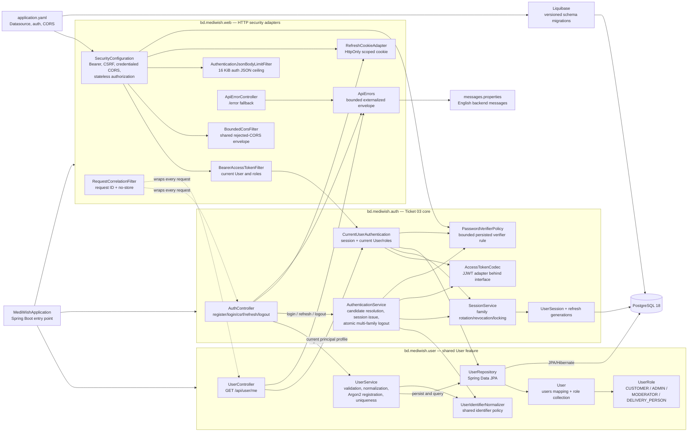
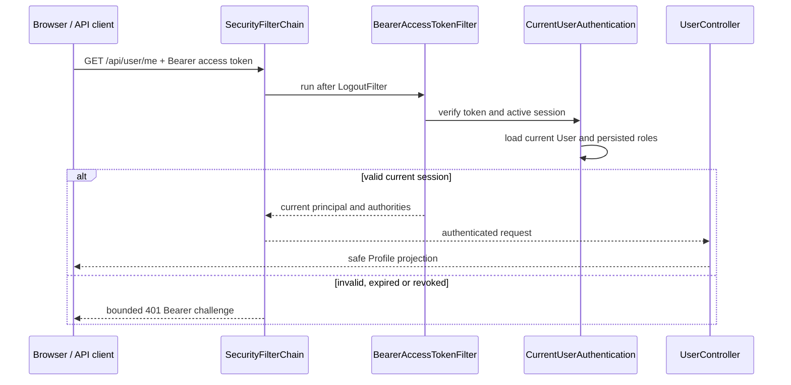

# Backend code architecture

This is the living code map for the current Spring Boot backend. Source files
remain authoritative; this page records package ownership, dependency
direction and the observable request boundaries.

**Last reviewed:** 2026-09-25
**Current scope:** health baseline, shared User profile/roles, and Ticket 03
password sessions with Bearer, CSRF, CORS and refresh-cookie adapters.
**Next boundary:** supported-browser session journey evidence. OTP, recovery,
MFA and deployment remain later boundaries.

## Package and dependency diagram

### Dependency rules

- `bd.mediwish.user` owns the shared User aggregate, role collection and safe
  profile projection. `bd.mediwish.auth` owns the authentication routes and
  registration credential boundary; `UserController` owns only `/api/user/me`.
- `bd.mediwish.web` consumes T2 interfaces. It must not parse JWTs, hash
  refresh values, lock session rows or call auth repositories directly.
- `AuthController` depends on the shared `RefreshCookieAdapter` only to read,
  set and clear the HTTP-only refresh cookie; the cookie adapter does not
  depend on the controller or authentication services.
- `CurrentUserAuthentication` is the only current-session/User handoff used by
  the bearer filter. Roles are loaded from the current User, never from JWT
  claims.
- `RefreshCookieAdapter` owns cookie flags and path. The raw refresh value is
  not returned in JSON, logged or placed in a URL.
- `PasswordVerifierPolicy` owns bounded persisted-verifier validation without
  password matching or credential logging. Current-user loading and refresh
  fail closed when the policy rejects stored state.
- `ApiErrors` remains the bounded `{ code, message, requestId }` projection;
  auth responses also use `Cache-Control: no-store`.
- `BoundedCorsFilter` reuses `SecurityConfiguration`'s single CORS source and
  converts rejected-origin responses to that envelope.
- `AuthenticationJsonBodyLimitFilter` applies a 16 KiB ceiling only to login
  and registration JSON before MVC deserialization.
- Liquibase owns schema evolution; JPA validates the PostgreSQL schema.

## Current request flows

### Registration and password session

`AuthController` exposes the fixed `/api/auth` routes. Registration and login
are public and CSRF-exempt because they do not authenticate with a cookie.
Refresh and logout require the CSRF header and read only the scoped refresh
cookie. The security chain applies the narrow auth-body limit before controller
deserialization and applies CORS policy before authorization. The controller
delegates sign-in, rotation and revocation to T2.

Logout revokes all distinct refresh-cookie families within one service
transaction. If any revocation fails, the transaction rolls back as a unit and
the controller does not clear the cookie as if logout had succeeded.

### Authenticated profile

## Cross-cutting boundaries

| Boundary | Current implementation | Maintained by |
| --- | --- | --- |
| Startup | Spring Boot, JPA, Liquibase and fail-closed auth configuration validation. | `MediWishApplication`, `application.yaml`, `SecurityConfiguration` |
| Authentication | Fixed-HS256 access JWTs and opaque refresh families from T2; Bearer and cookie serialization at the web edge. | `bd.mediwish.auth`, `BearerAccessTokenFilter`, `RefreshCookieAdapter` |
| Authorization | `/api/user/me` requires any current authenticated User; persisted roles are reloaded into authorities for role-aware consumers, but no current route requires a specific role. Unknown routes are denied. | `SecurityConfiguration`, `UserController`, `UserRole` |
| CSRF/CORS | Cookie CSRF with `XSRF-TOKEN`/`X-XSRF-TOKEN`, explicit credentialed origins and no wildcard origin; only local/dev/test profiles may use loopback fallback and rejected origins use the bounded error envelope. | `SecurityConfiguration`, `BoundedCorsFilter` |
| Error contract | Externalized English message plus bounded code/request ID and `no-store`. | `ApiErrors`, controllers, security handlers |
| Correlation/privacy | One bounded `X-Request-ID`; logs contain status and correlation only. | `RequestCorrelationFilter` |
| Database | PostgreSQL 18; Liquibase migrations; Hibernate validation only. | `db.changelog-master.yaml`, JPA mappings |

Update this page when a backend package, route, adapter, persistence boundary,
authentication transport or authorization rule changes. Do not diagram planned
OTP, recovery, MFA, catalog or order behavior as implemented.
