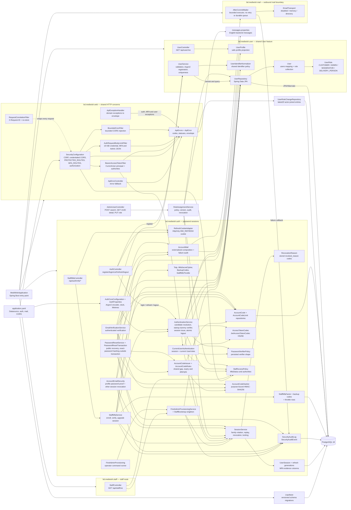

# Backend code architecture

This is the living code map for the current Spring Boot backend. Source files
remain authoritative; this page records package ownership, dependency
direction and the observable request boundaries.

**Last reviewed:** 2026-10-19
**Current scope:** health baseline, shared User profile/roles, Ticket 03
password sessions with Bearer, CSRF, CORS and refresh-cookie adapters, and
Ticket 06 first-Admin provisioning, staff TOTP MFA, security audit events and
the staff route, Ticket 11 profile editing with staged mobile changes, Ticket 12 saved addresses, Ticket 05 verified secondary-email recovery, Ticket 14 staff catalog, Ticket 15 Product images and Ticket 16 Discounts.
**Later boundaries:** mobile OTP, staff management beyond the current role/MFA workflows, and deployment.

Ticket08 adds `bd.mediwish.admin.AdminUserController`: strict JSON commands and UUID reads. It calls `auth.RoleAssignmentService`, which owns the role policy, bounded projections, audit persistence and atomic revocation because it shares the package-private SessionService. The User aggregate exposes one role and rolesVersion over the retained private role collection; PostgreSQL enforces exactly-one at commit. The Spring role hierarchy expands the single authority only at authorization; restricted MFA sessions hold no role authority. Password session creation locks the User FOR SHARE, rejects a password hash changed since verification, reads the current role, then writes sessions; bearer authentication holds the same User share lock while reading current session evidence, role and factor in one transaction, releasing it before route handling; role commands lock actor/target in UUID order before sessions.

## Package and dependency diagram



### Dependency rules

- `bd.mediwish.user` owns the shared User aggregate, role collection,
  registration and the `UserProfile` projection returned by sign-in, refresh
  and `/api/user/me`. `UserController` owns only `/api/user/me` and reads the
  `profile` of the principal by SpEL expression, so `user` depends on no
  other application package.
- `bd.mediwish.auth` owns the `/api/auth` routes (including `/api/auth/mfa/*`),
  the refresh cookie, session state and assurance, access tokens, the Argon2
  encoder bean, `AuthProperties`, staff MFA, first-Admin provisioning, the
  `staff_bootstrap` singleton and the security audit log. Only
  `AuthController` and `StaffMfaController` use `RefreshCookieAdapter`;
  session services never see cookie policy.
- `StaffMfaAttempts` supplies shared User/session checks, throttling, TOTP matching
  and failure outcomes inside the MFA service transaction; callers supply the time,
  and failures are thrown only after counted failures commit.
- `StaffMfaRecoveryService` coordinates backup-code consumption, verified factor replacement
  and regeneration under the same User lock. Argon2 runs before its transaction;
  factor/codes/session changes commit together. `StaffReplacementNotices` runs after
  commit through the profile-guarded notification adapter, so delivery failure cannot
  undo a replacement or suppress its fresh codes.
- `StaffAccessPolicy` is the single decision on staff assurance: it turns
  roles, the active factor and the session's evidence into an `MfaStatus` and
  authorities. `CurrentUserAuthentication` applies it on every request and
  `AuthenticationService` on every session response.
- `bd.mediwish.staff` owns only `GET /api/staff/me`. It depends on auth for
  the `CurrentUser` principal, `StaffAccessPolicy.isSuperAdmin` and
  `StaffBootstrapRepository`.
- `bd.mediwish.web` owns shared HTTP concerns. It depends on auth only through
  `CurrentUserAuthentication`, `AuthProperties`, `StaffAccessPolicy`'s
  authority constants and the public auth exceptions, and on user only for
  the registration exceptions. It must not parse JWTs,
  hash refresh values, lock session rows or call repositories.
- `ApiError` is the single list of error codes and statuses; every code has
  one `messages.properties` entry. Controllers throw domain exceptions and
  `ApiExceptionHandler` maps them; filters and security handlers write the
  same envelope through `ApiErrors.write`; `ApiErrorController` covers
  everything that reaches `/error`.
- `RequestCorrelationFilter` writes `X-Request-ID` and the default
  `Cache-Control: no-store`. Successful attached public image GET/HEAD responses
  replace that default with `public, max-age=60` in `PublicProductImageController`.
- `CurrentUserAuthentication` is the only current-session/User handoff for
  the bearer filter. Roles are loaded from the current User, never from JWT
  claims, and a staff role becomes an authority only for a session carrying
  evidence for the User's active factor. Its transaction locks the User FOR SHARE
  before session evidence and factor reads, preventing an old active-session
  read from being combined with a newly committed staff promotion. The lock
  ends when authentication returns; route handling is outside that transaction.
- `UserRepository.findByIdForUpdate` is the first lock of every MFA change
  (provisioning claims `staff_bootstrap` first); `SessionService.upgradeToMfa` and `SecurityAuditLog`
  require an existing transaction.
- `PasswordVerifierPolicy` decides whether a stored verifier is usable
  without hashing; sign-in, refresh and current-user loading fail closed on
  an unusable verifier.
- `SessionService.revokeAllForUser` revokes every session of a User; the
  first-Admin command calls it with `staff-provisioned`. The role-change HTTP command calls it with `role-changed` inside the role/audit/version transaction.
- Liquibase owns schema evolution, including constraints and indexes; JPA
  validates the PostgreSQL schema.

## Current request flows

### Registration and password session

`AuthController` exposes the fixed `/api/auth` routes. Registration and login
are public and CSRF-exempt. Bearer-only MFA POSTs, Admin search POST and role-change PUT are also CSRF-exempt. The CSRF bootstrap is a
safe `GET`. Refresh and logout require the CSRF header and read only the
scoped refresh cookie. The chain applies CORS, then the login/registration
body limit (also applied to MFA and Admin JSON commands), before controller deserialization.

Refresh without a cookie answers `204`: the browser is signed out. Every
refresh `401` clears the cookie. Logout revokes all distinct refresh-cookie
families within one transaction. It locks only the families, in ID order, and
never the refresh-token rows that a refresh locks first, so logouts and
refreshes cannot deadlock. If any revocation fails, the transaction rolls back
as a unit and the cookie is not cleared.

### Staff sign-in and MFA

A password sign-in by an `ADMIN` or `MODERATOR` gets a restricted session of
10 minutes: `mfa: ENROLLMENT_REQUIRED` (authority `MFA_ENROLLMENT`) without an
active factor, `VERIFICATION_REQUIRED` (authority `MFA_CHALLENGE`) with one.
`expiresIn` never exceeds the time left in the session. Protected staff/data routes
answer `403 MFA_REQUIRED` to that session. Customers and Delivery Persons
get `NOT_REQUIRED` and their full session as before.

A challenge session can redeem an unused backup code through `POST /api/auth/mfa/recovery`.
That revokes the presenting session and issues a factor-bound `REPLACEMENT_REQUIRED`
session with only `MFA_REPLACEMENT`, a fixed ten-minute expiry and enrollment access.
Verified replacement atomically revokes the old factor, deletes its codes, revokes all
sessions and activates the new factor with a new verified session and ten codes.
First-enrollment verification rejects any retained replacement binding as stale.
The post-commit notice adds `contactNotice` only to replacement verification responses.
A verified Admin or Moderator can regenerate unused codes with a fresh TOTP through
`POST /api/auth/mfa/backup-codes`; consumed rows and sessions remain. Both new routes
require exact JSON key sets and share the existing Bearer/CSRF/body-size boundaries.

```mermaid
sequenceDiagram
    participant B as Staff browser
    participant A as AuthController
    participant M as StaffMfaController
    participant S as StaffMfaService
    participant SS as SessionService

    B->>A: POST /api/auth/login
    A-->>B: restricted session (10 min), mfa ENROLLMENT_REQUIRED
    B->>M: POST /api/auth/mfa/enrollment + Bearer
    M->>S: lock User, replace pending factor, seal seed
    M-->>B: 201 enrollmentId, secret, otpauth URI, expiresIn 600
    B->>M: POST /api/auth/mfa/enrollment/verify {enrollmentId, code}
    S->>S: throttle check, TOTP check, activate factor, store backup verifiers
    S->>SS: upgradeToMfa: revoke restricted session (mfa-verified), create verified session
    M-->>B: VERIFIED session, new MW_REFRESH cookie, ten backup codes (once)
    Note over B,SS: Later sign-ins return VERIFICATION_REQUIRED;<br/>POST /api/auth/mfa/verify {code} upgrades the same way.
```

Codes are six-digit RFC 6238 TOTP with a window of one step either side, and a
step at or before the last accepted one is refused. Five wrong codes within 15
minutes lock verification for 15 minutes (`429 TOO_MANY_ATTEMPTS`); failures
commit even though the request fails. A replaced enrollment is `409
MFA_ENROLLMENT_STALE`, a wrong or replayed code `400 MFA_CODE_INVALID`. A
refresh keeps the session's evidence and absolute expiry, and the policy is
re-evaluated, so a revoked factor or a removed role takes effect on the next
request. The MFA routes need a Bearer token and no CSRF token, and are body
limited like sign-in. Each step writes a `security_audit_events` row.

### First-Admin provisioning

The operator runs the packaged application as a non-web command:
`java -jar target/medi-wish.jar --spring.main.web-application-type=none
--app.provisioning.first-admin-username=<username>`. `FirstAdminProvisioning`
refuses to run inside a web context. In one transaction the service finds the
named User with a usable password verifier, claims the `staff_bootstrap`
singleton (a concurrent run waits on that row), refuses and rolls back when it
was already claimed, an `ADMIN` exists or no such User exists, and otherwise
locks the User, replaces their role with `ADMIN`, revokes the User's sessions
(`staff-provisioned`) and writes an audit event. It logs `provisioned` or
`refused: <reason>` without the username and exits 0 or 1. The bootstrap is
never reopened; the provisioned User is the Super Admin while they hold `ADMIN`.

### Authenticated profile

```mermaid
sequenceDiagram
    participant B as Browser / API client
    participant S as SecurityFilterChain
    participant F as BearerAccessTokenFilter
    participant C as CurrentUserAuthentication
    participant U as UserController

    B->>S: GET /api/user/me + Bearer access token
    S->>F: PROTECTED_ROUTES match, after LogoutFilter
    F->>C: verify token
    C->>C: transaction: lock User FOR SHARE, check session and current role/factor
    C->>C: StaffAccessPolicy result; release User lock before route handling
    alt valid current session
        F-->>S: CurrentUser principal and granted authorities
        S-->>U: authenticated request
        U-->>B: UserProfile
    else staff session without MFA evidence
        S-->>B: 403 MFA_REQUIRED
    else invalid, expired or revoked
        S-->>B: bounded 401 Bearer challenge
    end
```

## Cross-cutting boundaries

| Boundary | Current implementation | Maintained by |
| --- | --- | --- |
| Startup | Spring Boot, JPA validation and Liquibase. Auth lifetimes must be at least one second; the JWT key is built once from a Base64 secret of at least 32 bytes; non-Secure cookies and the loopback CORS fallback require every active profile to be `local` or `test`; hosted CORS origins must be explicit. The MFA key `APP_AUTH_MFA_SECRET_KEY` must decode to exactly 32 bytes and every MFA setting must be present and positive. `SecurityConfiguration` loads only in a servlet web application, so the non-web first-Admin command starts without it. | `MediWishApplication`, `application.yaml`, `AuthProperties`, `JwtAccessTokenCodec`, `MfaSecretCipher`, `SecurityConfiguration` |
| Authentication | HS256 access JWTs requiring `iss`, `aud`, `sub`, `sid`, `jti`, `iat`, `exp` and `typ=access+jwt`; opaque refresh families stored as SHA-256 digests; Bearer and cookie serialization at the edge. Staff sessions add TOTP verification recorded on the session. | `bd.mediwish.auth`, `BearerAccessTokenFilter` |
| Authorization | `GET /api/user/me` needs any of the four roles; `GET /api/staff/me` needs `ADMIN` or `MODERATOR`; the enrollment routes need `MFA_ENROLLMENT` or `MFA_REPLACEMENT`; `/api/auth/mfa/verify` and `/api/auth/mfa/recovery` need `MFA_CHALLENGE`; `/api/auth/mfa/backup-codes` needs the Moderator role (including Admin through the role hierarchy). Persisted roles become authorities only through `StaffAccessPolicy`, so a staff role applies only to an MFA-verified session. A denied staff session that still needs MFA gets `403 MFA_REQUIRED`, any other denial `403 ACCESS_DENIED`. Unknown routes are denied. | `SecurityConfiguration`, `StaffAccessPolicy`, `CurrentUserAuthentication`, `UserRole` |
| CSRF/CORS | Cookie CSRF with `XSRF-TOKEN`/`X-XSRF-TOKEN`; explicit credentialed origins with `Authorization`, `Content-Type` and `X-XSRF-TOKEN` headers; rejected origins use the bounded envelope. | `SecurityConfiguration`, `BoundedCorsFilter` |
| Error contract | `{ code, message, requestId }` with English messages; unmapped 4xx become `INVALID_REQUEST`, 429 `TOO_MANY_ATTEMPTS` and 5xx `INTERNAL_ERROR`. MFA adds `MFA_CODE_INVALID` (400), `MFA_REQUIRED` (403) and `MFA_ENROLLMENT_STALE` (409). Unreadable-JSON and persistence messages never reach responses or logs. | `ApiError`, `ApiErrors`, `ApiExceptionHandler`, `ApiErrorController` |
| Correlation/privacy | One server-generated `X-Request-ID` on every response; default `no-store`, except successful attached public image GET/HEAD uses `public, max-age=60`. Logs contain status and correlation only. Security audit events take the request ID from the MDC and store no codes, seeds or usernames. | `RequestCorrelationFilter`, `SecurityAuditLog` |
| Database | PostgreSQL 18; Liquibase migrations; Hibernate validation only; every statement bounded by the three-second socket timeout. | `db.changelog-master.yaml`, `application.yaml`, JPA mappings |

Update this page when a backend package, route, adapter, persistence boundary,
authentication transport or authorization rule changes. Do not diagram planned
mobile OTP or order behavior as implemented.

## Ticket 11 profile boundary

ProfileController exposes only GET/PUT /api/user/me/profile and POST/DELETE /api/user/me/mobile-change, derives ownership from the current Bearer principal, and checks exact JSON keys/types. ProfileRules and IdentifierFormats own pure validation; ProfileService and MobileChangeService take the users row lock before mutations. ProfileService uses a constructor projection with a pending-mobile left join, avoiding an eager role fetch on reads. Changeset 012 adds the optional name/DOB, explicit edit version, closure state and one pending row per user. Bulk delete reaches the database before a replacement insert; activation catches uniqueness failure around the auto-flushing delete and rolls back the entire transaction. STALE_UPDATE and ACCOUNT_CLOSING use the shared bounded error envelope. The internal activation method belongs to the future OTP verifier; no HTTP handler invokes it.

## Ticket 14 catalog boundary

`bd.mediwish.catalog` owns pure Product and money rules, Category/Product/history JPA mappings, repositories, and transactional services. Categories and Products are created with PostgreSQL `INSERT ... ON CONFLICT (id) DO NOTHING`; a matching normalized request receives the stored record and a changed payload conflicts. Mutations lock one Product or Category row, reject stale changed intent, and keep history in the same transaction. Product search is paged; history username projections avoid loading each actor's role collection. The shared `bd.mediwish.web` package enforces the staff catalog/pricing route matrix, current-role MFA access, bounded catalog errors and authorized JSON body limits. CatalogController delegates through strict catalog-local request shapes without changing authentication JSON binding.

## Ticket 15 Product images

`bd.mediwish.catalog.ProductImageService` manages image metadata independently of the Product's catalog version/history. Staff image routes require the existing verified Admin/Moderator policy; the public GET/HEAD route serves only attached image IDs. Multipart input contains the client image UUID, one file, optional alt text and an optional same-Product replacement ID. Neither a storage key nor a remote URL enters that contract.

Inspection validates PNG/JPEG input, 3 MiB and 4096-pixel limits, then re-encodes outside a database transaction. Two decode permits bound concurrent decoding. Mutations lock the Product row, preserve contiguous positions, enforce replay/retired-ID rules, and check the deferred unique-order constraint before committing. Remove and replace delete the previous object synchronously after commit; guarded compensation removes a newly created unreferenced object after rollback. Logged warnings exclude object keys and request data.

`bd.mediwish.storage.ObjectStorage` is the provider boundary: create-only put, optional streamed get and idempotent delete. `LocalObjectStorage` confines canonical Product-owned keys to the configured root and namespace. `StorageConfiguration` checks required settings after singleton construction and refuses local storage outside local/test profiles. Servlet-only beans keep the first-Admin offline command independent of image storage. Hosted adapters and orphan sweeping remain Ticket 57 scope.
## Ticket 16 current-pricing boundary

The catalog feature owns Discount entities, command rules/audit repositories, Dhaka calendar, exact-decimal calculator, CurrentPrices and derived Product history. Staff commands reuse pricing authorization, lock one Discount row and commit its audit snapshot atomically. Repeatable-read Product/Discount reads capture the business date once and batch candidate lookup, target labels/counts and usernames. CurrentPrices is the shared immutable-snapshot boundary for future carts and accepted Orders; no Order persistence or background scheduler is added here.
## Ticket 12 saved-address boundary

bd.mediwish.address owns strict owner-only JSON routes, pure normalization/default/calendar rules, the composite-key entity, native repository and User-locked transactional service. Every mutation takes the User lock before addresses or change rows; reads remain available while closing. Shared web security authorizes all four roles, bounds command bodies and errors, and keeps personal values out of logs. Configured Dhaka week/month counts and address writes share the transaction. Ticket 25's optional save must call create in a separate request after the Order commits.

## Ticket 05 verified secondary email and password recovery

`auth` owns account codes, HMACs, recovery, verification and the profile email-security facade. `user` owns the verified timestamp and safe profile projection. Verification and reset codes have separate purpose-bound HMACs and separate rows; both share the same per-User issue window and sixty-second gap. A distinct required Base64 32-byte recovery key protects low-entropy codes and opaque address-rate keys. Existing Users remain unverified until successful verification. Staff roles do not change recovery eligibility, and password recovery does not alter MFA factors, backup codes, roles, profile version or pending mobile changes.

Reset requests first atomically count the normalized address key, then silently refuse unavailable or limited accounts. They lock the User, refresh an already managed lookup, and recheck the exact typed address ignoring case and current eligibility before issuing. Code creation, expiry and the shared issuance gap use a fresh Clock instant after lock acquisition, rather than a delayed request arrival time. All User-dependent work precedes opportunistic cleanup; the native age cleanup skips locked limit rows to avoid waiting on concurrent counter updates. Confirmation hashes every accepted typed replacement password outside the database transaction, including unknown accounts. The separate transaction returns INVALID so wrong attempts/deletion commit before the public generic error. Five wrong attempts consume the purpose row; success flushes the password mutation before bulk-clearing all code rows, revokes all families, audits and registers a notice.

Profile email changes require the current password after no-op/version checks and before uniqueness probes. The User lock serializes the bounded wrong-password counter; only CurrentPasswordInvalidException is excluded from rollback. The profile mutation clears verification and is flushed before code deletion clears JPA state. A real change revokes other sessions while retaining the current session, and notifies a previously verified old address. Name-only and no-op saves require no password. Session creation also compares the verifier captured before password verification with the fresh locked User hash, preventing a stale concurrent sign-in from surviving password reset.

`AccountMail` composes four English messages through MessageSource, then registers an after-commit callback. `mail` sends on one worker with a queue of 200; this preserves enqueue order, not global transaction-commit order. There is no durable copy, retry or network mail provider. Rollback sends nothing. Queue rejection or transport failure runs one sanitized callback that records EMAIL_DELIVERY_FAILED in REQUIRES_NEW without logging content or reverting committed domain state. Disabled transport is allowed everywhere; memory and directory capture require local/test profiles. Capture is a controlled development/test adapter, not a public read endpoint. Production acceptance in this ticket does not claim deliverability while mail is disabled.

Tests separate pure rules/HMAC/password boundaries, service decisions through repository seams, after-commit/executor behavior, and PostgreSQL persistence/concurrency. Controller, authorization, CSRF, bounded-error and browser contracts remain separate verification gates. Matching source mirrors and the index describe each class and test.

Ticket 05 HTTP wiring: the two public password-reset POST commands share credential CSRF exemptions and 16 KiB limits, ignore bearer headers and issue no session. The two owner email-verification POST commands share bearer/MFA authorization and limits with profile commands. Strict controller JSON validation precedes service transactions, while bounded recovery exceptions reuse the common correlated no-store error envelope.
