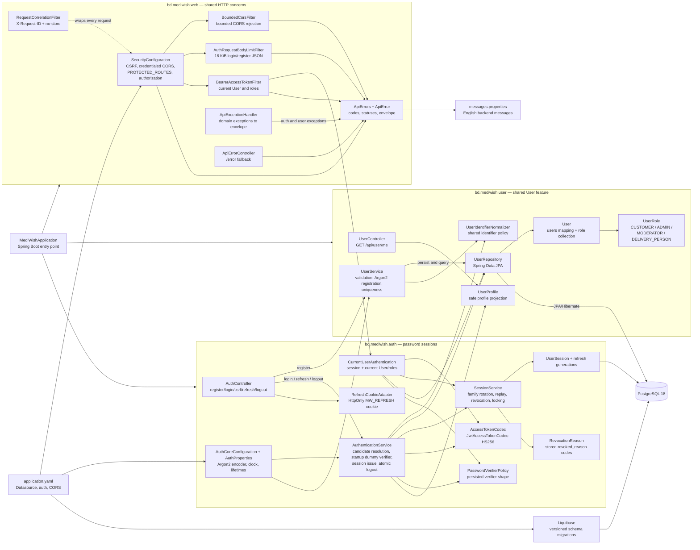
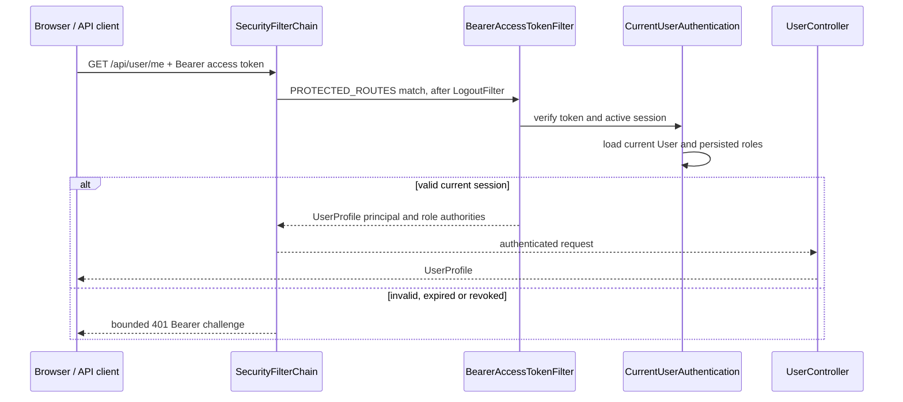

# Backend code architecture

This is the living code map for the current Spring Boot backend. Source files
remain authoritative; this page records package ownership, dependency
direction and the observable request boundaries.

**Last reviewed:** 2026-09-26
**Current scope:** health baseline, shared User profile/roles, and Ticket 03
password sessions with Bearer, CSRF, CORS and refresh-cookie adapters.
**Next boundary:** supported-browser session journey evidence. OTP, recovery,
MFA and deployment remain later boundaries.

## Package and dependency diagram

### Dependency rules

- `bd.mediwish.user` owns the shared User aggregate, role collection,
  registration and the `UserProfile` projection returned by sign-in, refresh
  and `/api/user/me`. `UserController` owns only `/api/user/me` and returns
  the `UserProfile` principal, so `user` depends on no
  other application package.
- `bd.mediwish.auth` owns the `/api/auth` routes, the refresh cookie, session
  state, access tokens, the Argon2 encoder bean and `AuthProperties`. Only
  `AuthController` uses `RefreshCookieAdapter`; session services never see
  cookie policy.
- `bd.mediwish.web` owns shared HTTP concerns. It depends on auth only through
  `CurrentUserAuthentication`, `AuthProperties` and the public auth exceptions,
  and on user only for the registration exceptions. It must not parse JWTs,
  hash refresh values, lock session rows or call repositories.
- `ApiError` is the single list of error codes and statuses; every code has
  one `messages.properties` entry. Controllers throw domain exceptions and
  `ApiExceptionHandler` maps them; filters and security handlers write the
  same envelope through `ApiErrors.write`; `ApiErrorController` covers
  everything that reaches `/error`.
- `RequestCorrelationFilter` is the only writer of `X-Request-ID` and
  `Cache-Control: no-store`.
- `CurrentUserAuthentication` is the only current-session/User handoff for
  the bearer filter. Roles are loaded from the current User, never from JWT
  claims.
- `PasswordVerifierPolicy` decides whether a stored verifier is usable
  without hashing; sign-in, refresh and current-user loading fail closed on
  an unusable verifier.
- `SessionService.revokeAllForUser` is the internal interface for later
  password recovery, role and account changes; no current route calls it.
- Liquibase owns schema evolution, including constraints and indexes; JPA
  validates the PostgreSQL schema.

## Current request flows

### Registration and password session

`AuthController` exposes the fixed `/api/auth` routes. Registration and login
are public and are the only CSRF-exempt requests. The CSRF bootstrap is a
safe `GET`. Refresh and logout require the CSRF header and read only the
scoped refresh cookie. The chain applies CORS, then the login/registration
body limit, before controller deserialization.

Refresh without a cookie answers `204`: the browser is signed out. Every
refresh `401` clears the cookie. Logout revokes all distinct refresh-cookie
families within one transaction in a fixed order; if any revocation fails,
the transaction rolls back as a unit and the cookie is not cleared.

### Authenticated profile

## Cross-cutting boundaries

| Boundary | Current implementation | Maintained by |
| --- | --- | --- |
| Startup | Spring Boot, JPA validation and Liquibase. Auth lifetimes must be at least one second; the JWT key is built once from a Base64 secret of at least 32 bytes; non-Secure cookies and the loopback CORS fallback require every active profile to be `local` or `test`; hosted CORS origins must be explicit. | `MediWishApplication`, `application.yaml`, `AuthProperties`, `JwtAccessTokenCodec`, `SecurityConfiguration` |
| Authentication | HS256 access JWTs requiring `iss`, `aud`, `sub`, `sid`, `jti`, `iat`, `exp` and `typ=access+jwt`; opaque refresh families stored as SHA-256 digests; Bearer and cookie serialization at the edge. | `bd.mediwish.auth`, `BearerAccessTokenFilter` |
| Authorization | `PROTECTED_ROUTES` (`GET /api/user/me`) requires any current authenticated User; persisted roles become authorities for role-aware consumers. Unknown routes are denied. | `SecurityConfiguration`, `UserController`, `UserRole` |
| CSRF/CORS | Cookie CSRF with `XSRF-TOKEN`/`X-XSRF-TOKEN`; explicit credentialed origins with `Authorization`, `Content-Type` and `X-XSRF-TOKEN` headers; rejected origins use the bounded envelope. | `SecurityConfiguration`, `BoundedCorsFilter` |
| Error contract | `{ code, message, requestId }` with English messages; unmapped 4xx become `INVALID_REQUEST` and 5xx `INTERNAL_ERROR`. Unreadable-JSON and persistence messages never reach responses or logs. | `ApiError`, `ApiErrors`, `ApiExceptionHandler`, `ApiErrorController` |
| Correlation/privacy | One server-generated `X-Request-ID` and `no-store` on every response; logs contain status and correlation only. | `RequestCorrelationFilter` |
| Database | PostgreSQL 18; Liquibase migrations; Hibernate validation only; every statement bounded by the three-second socket timeout. | `db.changelog-master.yaml`, `application.yaml`, JPA mappings |

Update this page when a backend package, route, adapter, persistence boundary,
authentication transport or authorization rule changes. Do not diagram planned
OTP, recovery, MFA, catalog or order behavior as implemented.
