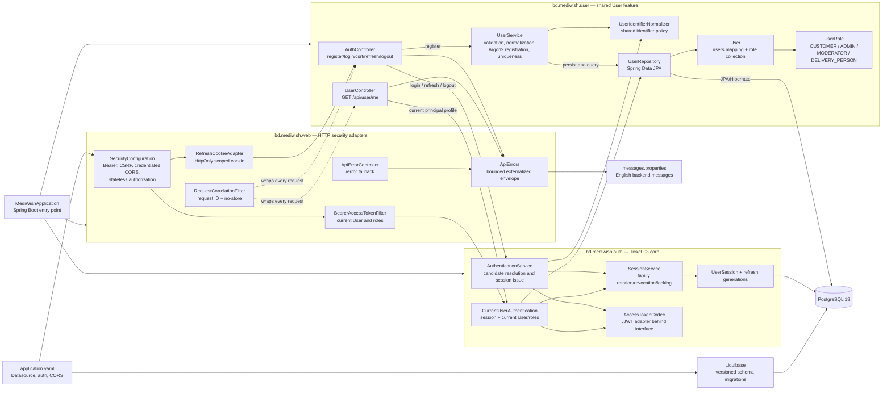
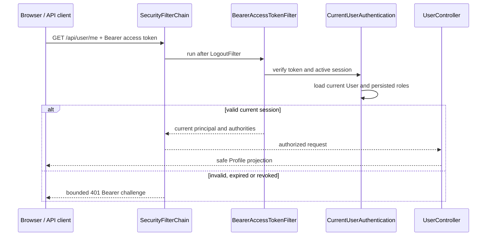

# Backend code architecture

This is the living code map for the current Spring Boot backend. Source files
remain authoritative; this page records package ownership, dependency
direction and the observable request boundaries.

**Last reviewed:** 2026-09-19
**Current scope:** health baseline, shared User profile/roles, and Ticket 03
password sessions with Bearer, CSRF, CORS and refresh-cookie adapters.
**Next boundary:** supported-browser session journey evidence. OTP, recovery,
MFA and deployment remain later boundaries.

## Package and dependency diagram

### Dependency rules

- `bd.mediwish.user` owns the shared User aggregate, role collection and safe
  profile projection. `AuthController` owns registration because it creates
  the credential boundary; `UserController` owns only `/api/user/me`.
- `bd.mediwish.web` consumes T2 interfaces. It must not parse JWTs, hash
  refresh values, lock session rows or call auth repositories directly.
- `CurrentUserAuthentication` is the only current-session/User handoff used by
  the bearer filter. Roles are loaded from the current User, never from JWT
  claims.
- `RefreshCookieAdapter` owns cookie flags and path. The raw refresh value is
  not returned in JSON, logged or placed in a URL.
- `ApiErrors` remains the bounded `{ code, message, requestId }` projection;
  auth responses also use `Cache-Control: no-store`.
- Liquibase owns schema evolution; JPA validates the PostgreSQL schema.

## Current request flows

### Registration and password session

`AuthController` exposes the fixed `/api/auth` routes. Registration and login
are public and CSRF-exempt because they do not authenticate with a cookie.
Refresh and logout require the CSRF header and read only the scoped refresh
cookie. The controller delegates sign-in, rotation and revocation to T2.

### Authenticated profile

## Cross-cutting boundaries

| Boundary | Current implementation | Maintained by |
| --- | --- | --- |
| Startup | Spring Boot, JPA, Liquibase and fail-closed auth configuration validation. | `MediWishApplication`, `application.yaml`, `SecurityConfiguration` |
| Authentication | Fixed-HS256 access JWTs and opaque refresh families from T2; Bearer and cookie serialization at the web edge. | `bd.mediwish.auth`, `BearerAccessTokenFilter`, `RefreshCookieAdapter` |
| Authorization | Only the current User principal and persisted roles authorize `/api/user/me`; unknown routes are denied. | `SecurityConfiguration`, `UserController`, `UserRole` |
| CSRF/CORS | Cookie CSRF with `XSRF-TOKEN`/`X-XSRF-TOKEN`, explicit credentialed origins and no wildcard origin. | `SecurityConfiguration` |
| Error contract | Externalized English message plus bounded code/request ID and `no-store`. | `ApiErrors`, controllers, security handlers |
| Correlation/privacy | One bounded `X-Request-ID`; logs contain status and correlation only. | `RequestCorrelationFilter` |
| Database | PostgreSQL 18; Liquibase migrations; Hibernate validation only. | `db.changelog-master.yaml`, JPA mappings |

Update this page when a backend package, route, adapter, persistence boundary,
authentication transport or authorization rule changes. Do not diagram planned
OTP, recovery, MFA, catalog or order behavior as implemented.
