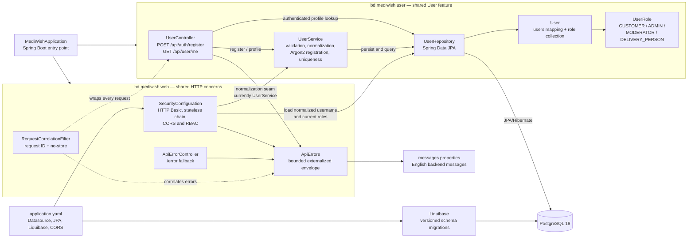
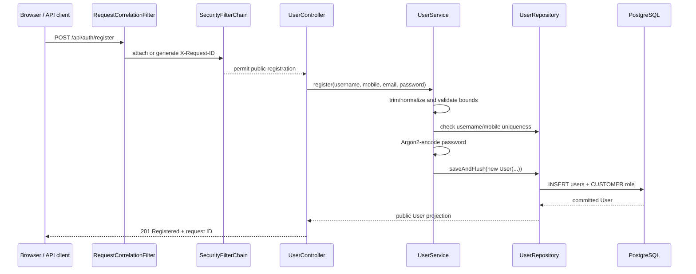
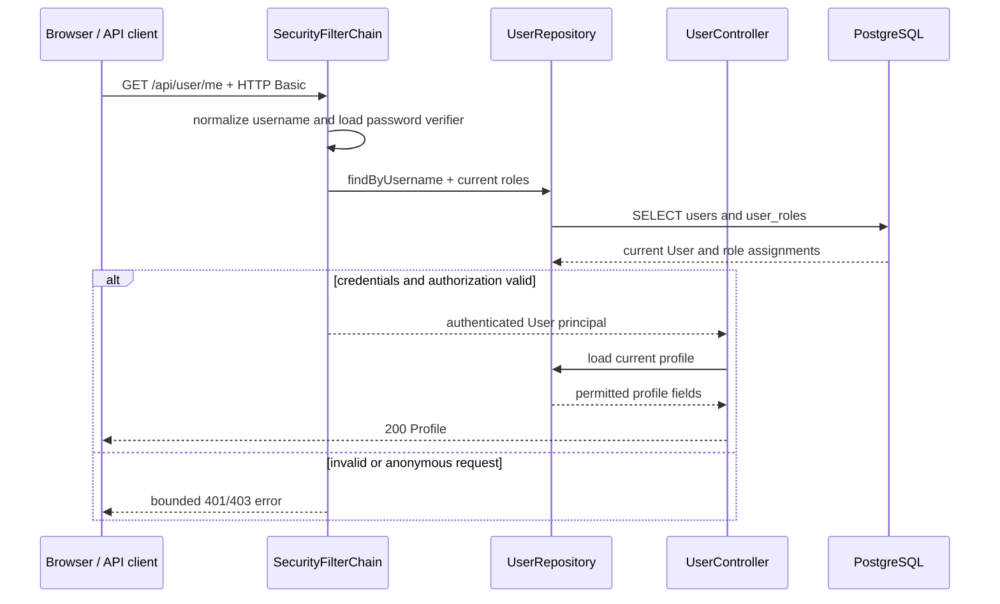

# Backend code architecture

This is the living code map for the current Spring Boot backend. The source
tree remains authoritative; this page explains package ownership, dependency
direction and the observable request paths.

**Last reviewed:** 2026-09-18 
**Current scope:** health baseline plus the Ticket 02 shared User resource,
simple HTTP Basic authentication and role-based authorization. 
**Next boundary:** Ticket 03 replaces the credential transport with the planned
JWT/session design while retaining the shared User identity/profile boundary.

## Package and dependency diagram

### Dependency rules

- `bd.mediwish.user` owns the shared User aggregate, its role collection,
  registration policy, persistence interface and current User-shaped routes.
  Customer, Admin, Moderator and DeliveryPerson are roles, not separate
  identity packages.
- `bd.mediwish.web` owns cross-cutting HTTP behavior. It may use the current
  User authentication boundary, but Ticket 03.T1 must revisit the temporary
  normalization seam and decide whether a larger auth surface warrants an
  `AuthController` split.
- `UserRepository` is the persistence boundary. The service performs
  validation, normalization, password encoding, pre-checks and race-safe
  duplicate mapping; database constraints remain authoritative.
- Liquibase owns schema evolution. JPA validates the database mapping and does
  not create or update tables.
- `ApiErrors` is the single bounded error projection: `{ code, message,
  requestId }`. Ordinary responses and logs do not expose credentials or
  internal exception details.

## Current request flows

### Registration

### Authenticated profile

## Cross-cutting boundaries

| Boundary | Current implementation | Maintained by |
| --- | --- | --- |
| Startup | `MediWishApplication` loads Spring Boot, JPA and Liquibase. | `MediWishApplication.java`, `application.yaml` |
| Authentication | Stateless HTTP Basic for Ticket 02; Argon2 verifier; current roles loaded from `user_roles`. | `SecurityConfiguration`, `UserRepository` |
| Authorization | `/api/user/**` requires authentication; role-aware rules are the foundation for future protected routes. | `SecurityConfiguration`, `UserRole` |
| Error contract | Externalized English message plus bounded code/status/request ID; `Cache-Control: no-store`. | `ApiErrors`, `ApiErrorController` |
| Correlation/privacy | Accepts one bounded `X-Request-ID` or generates one; logs status and correlation only. | `RequestCorrelationFilter` |
| Database | PostgreSQL 18; Liquibase migrations; Hibernate validation only. | `db.changelog-master.yaml`, JPA mappings |

## Update checklist

Update this page whenever a backend package, route, adapter, persistence
boundary, authentication transport, authorization rule, error contract or
startup integration changes. Keep the package diagram aligned with actual
imports and keep the sequence diagrams aligned with tested API behavior. Add a
new node only when the corresponding source, test and documentation exist;
do not diagram planned OTP/session/catalog/order behavior as implemented.
