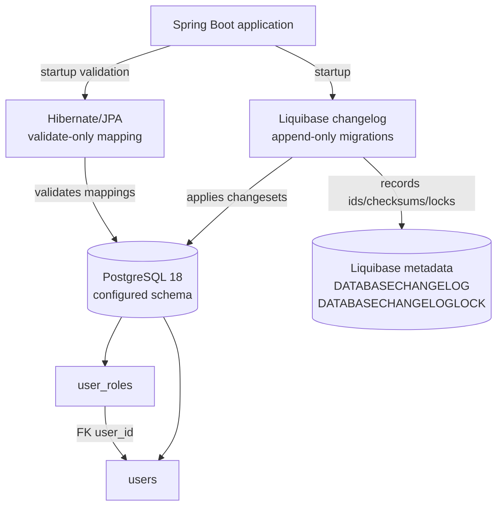
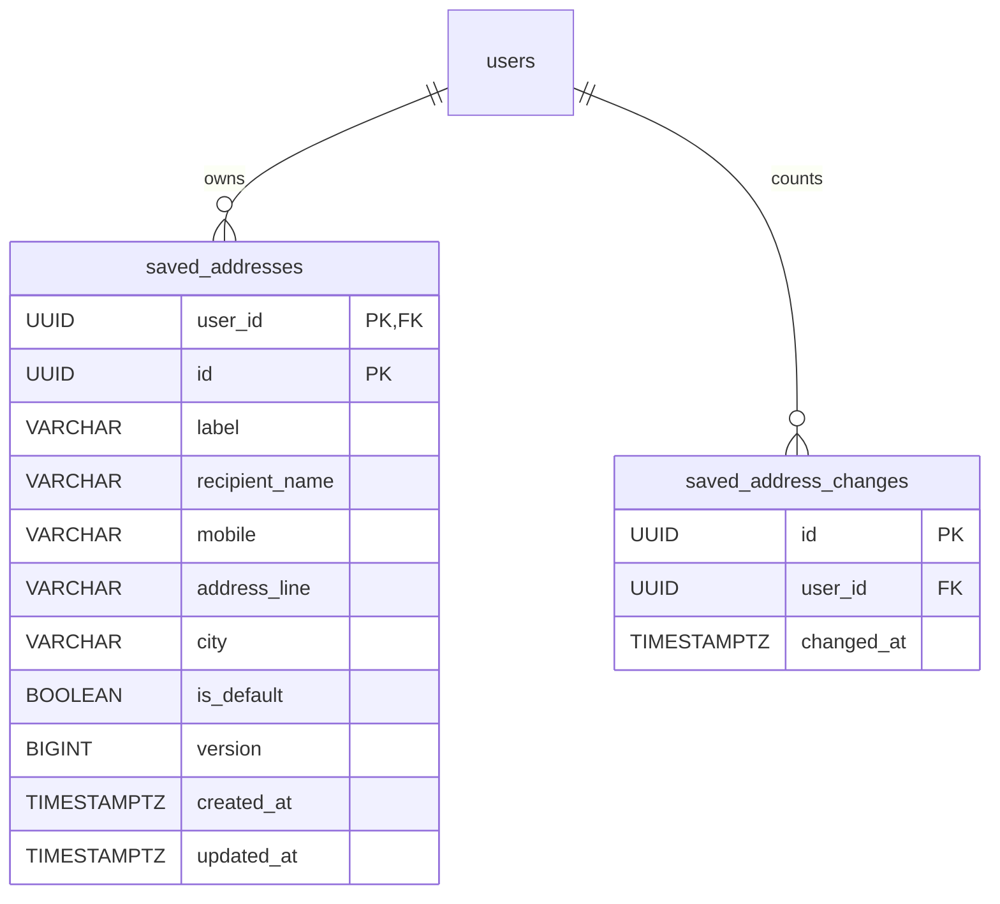

# Backend database architecture

This is the living database architecture map for the backend. It describes the
schema that is currently created by Liquibase and mapped by JPA; it is not a
design claim for tables that belong to later tickets.

**Last reviewed:** 2026-10-19 
**Current scope:** Ticket 01 health baseline, Ticket 02 shared User
registration/RBAC foundation, Ticket 03 durable password sessions and Ticket 06
staff MFA, first-Admin bootstrap and security audit events, plus Ticket 05 verified secondary-email recovery, Ticket 08 single-role assignment and audit, Ticket 11 Customer profile and staged mobile changes, Ticket 12 saved addresses, Ticket 14 catalog, Ticket 15 image metadata and Ticket 16 Discounts. 
**Schema source of truth:** [`src/main/resources/db/changelog/db.changelog-master.yaml`](../src/main/resources/db/changelog/db.changelog-master.yaml) 
**Runtime rule:** Liquibase owns schema changes; Hibernate runs with
`ddl-auto: validate` and must not create or alter tables. Unique
constraints, indexes and foreign keys are declared only in the changelog;
JPA entities map tables and columns without repeating them.

## Current entity-relationship diagram

```mermaid
erDiagram
    USERS ||--|| USER_ROLES : "has exactly one role"
    USERS ||--o{ USER_SESSIONS : "owns session families"
    USER_SESSIONS ||--o{ SESSION_REFRESH_TOKENS : "rotates generations"
    USERS ||--o{ STAFF_MFA_FACTORS : "enrolls authenticators"
    STAFF_MFA_FACTORS ||--o{ STAFF_MFA_BACKUP_CODES : "issues backup codes"
    STAFF_MFA_FACTORS |o--o{ USER_SESSIONS : "is MFA evidence for"
    USERS ||--o| STAFF_MFA_THROTTLE : "counts failed codes"
    USERS |o--o| STAFF_BOOTSTRAP : "is the Super Admin"
    USERS |o--o{ SECURITY_AUDIT_EVENTS : "is the subject of"
    USERS ||--o| USER_MOBILE_CHANGES : "stages one replacement"
    USERS ||--o{ ACCOUNT_CODES : "owns one code per purpose"

    ACCOUNT_CODES {
        UUID id PK "purpose-bound HMAC identity"
        UUID user_id FK "cascade delete"
        VARCHAR_32 purpose "EMAIL_VERIFICATION or PASSWORD_RESET"
        CHAR_64 code_hash "HMAC-SHA256 lowercase hex; never raw code"
        VARCHAR_320 sent_to "address binding; not diagnostic output"
        TIMESTAMPTZ created_at
        TIMESTAMPTZ expires_at "strictly after creation"
        SMALLINT failed_attempts "0 through 5"
    }
    ACCOUNT_CODE_LIMITS {
        VARCHAR_96 limit_key PK "issue/password UUID key or address HMAC"
        TIMESTAMPTZ window_started_at
        INT attempts "nonnegative; stores refused address requests too"
        TIMESTAMPTZ last_at "gap survives window rollover"
    }

    USERS {
        UUID id PK "Java-generated User identity"
        VARCHAR_50 username UK "trimmed, lowercase, immutable"
        VARCHAR_30 mobile UK "11 ASCII digits for new writes"
        VARCHAR_320 email "nullable; unique ignoring case"
        TIMESTAMPTZ email_verified_at "nullable; requires a non-null email"
        VARCHAR_100 full_name "nullable; normalized Customer display name"
        DATE date_of_birth "nullable; cannot be future in Dhaka"
        BIGINT profile_version "non-null; starts at 0"
        VARCHAR_24 account_state "ACTIVE or CLOSURE_REQUESTED"
        VARCHAR_255 password_hash "Argon2 verifier only"
        BOOLEAN mobile_verified "false until final OTP work"
        TIMESTAMPTZ created_at "Java-created Instant"
        BIGINT roles_version "increments on actual role change"
    }

    USER_ROLES {
        UUID user_id PK, FK "references users.id; cascade delete"
        VARCHAR_32 role "one of four role names"
    }

    USER_MOBILE_CHANGES {
        UUID id PK "pending change identity"
        UUID user_id FK, UK "one pending row per User; cascade delete"
        VARCHAR_11 new_mobile "staged replacement; not yet active"
        TIMESTAMPTZ requested_at
    }

    USER_SESSIONS {
        UUID id PK "JWT sid and family identity"
        UUID user_id FK "cascade to User"
        TIMESTAMPTZ created_at
        TIMESTAMPTZ expires_at
        TIMESTAMPTZ last_used_at
        TIMESTAMPTZ revoked_at
        VARCHAR_64 revoked_reason "RevocationReason code"
        UUID mfa_factor_id FK "nullable; set null when the factor is deleted"
        TIMESTAMPTZ mfa_verified_at "nullable; with mfa_factor_id"
    }

    SESSION_REFRESH_TOKENS {
        UUID id PK
        UUID session_id FK
        BIGINT generation UK "unique within family"
        VARCHAR_64 token_hash UK "SHA-256 lowercase hex only"
        TIMESTAMPTZ issued_at
        TIMESTAMPTZ expires_at
        TIMESTAMPTZ consumed_at
    }

    STAFF_MFA_FACTORS {
        UUID id PK "also the AES-GCM associated data"
        UUID user_id FK "cascade to User"
        VARCHAR_16 status "PENDING, ACTIVE or REVOKED"
        BYTEA secret_ciphertext "sealed TOTP seed"
        BYTEA secret_nonce "12-byte GCM nonce"
        TIMESTAMPTZ created_at
        TIMESTAMPTZ pending_expires_at
        TIMESTAMPTZ activated_at
        TIMESTAMPTZ revoked_at
        BIGINT last_used_step "default -1; replay guard"
    }

    STAFF_MFA_BACKUP_CODES {
        UUID id PK
        UUID factor_id FK "cascade to factor"
        VARCHAR_255 code_verifier "Argon2 verifier only"
        TIMESTAMPTZ created_at
        TIMESTAMPTZ consumed_at
    }

    STAFF_MFA_THROTTLE {
        UUID user_id PK, FK "cascade to User"
        INT failed_count
        TIMESTAMPTZ window_started_at
        TIMESTAMPTZ locked_until
    }

    STAFF_BOOTSTRAP {
        SMALLINT id PK "always 1"
        UUID super_admin_user_id FK "set null when the User is deleted"
        TIMESTAMPTZ provisioned_at
    }

    USERS |o--o{ USER_ROLE_CHANGES : "is actor or target"
    USER_ROLE_CHANGES {
        UUID id PK
        TIMESTAMPTZ occurred_at
        UUID actor_user_id FK "nullable on deletion"
        UUID target_user_id FK "nullable on deletion"
        VARCHAR_32 old_role
        VARCHAR_32 new_role
        VARCHAR_64 request_id
    }

    SECURITY_AUDIT_EVENTS {
        UUID id PK
        TIMESTAMPTZ occurred_at
        VARCHAR_64 event_type "fixed event name"
        UUID subject_user_id FK "set null when the User is deleted"
        UUID session_id "no FK"
        VARCHAR_64 request_id "X-Request-ID"
    }
```

`USER_ROLES` has primary key `user_id`, a check for the four names and deferred required-role triggers: every committed User has exactly one role. The permission order is CUSTOMER < DELIVERY_PERSON < MODERATOR < ADMIN. The migration keeps the highest legacy role, fills CUSTOMER for roleless legacy accounts and leaves existing sessions, owner pointer and audit unchanged.

## Persistence and migration boundary

The integration harness points the same migration pipeline at an isolated
PostgreSQL schema. It does not use a second schema model or an in-memory
substitute.

## Current tables and invariants

| Table | Ownership | Important columns and constraints | Meaning |
| --- | --- | --- | --- |
| `users` | `bd.mediwish.user.User` | `id` primary key; `username` unique and not null; `mobile` unique and not null; optional `email_verified_at`, permitted only with non-null email; optional `email`, unique ignoring case through `uk_users_email_upper` on `upper(email)`; non-null `password_hash`; non-null `mobile_verified`; non-null `created_at`; `roles_version` default zero; optional `full_name` and `date_of_birth`; `profile_version` default zero; `account_state` default `ACTIVE`, checked by `ck_users_account_state` | Shared identity/profile and credential verifier for Customers and staff roles. |
| `account_codes` | `bd.mediwish.auth.AccountCode` | UUID primary key; cascading User FK; unique `(user_id,purpose)`; two-purpose CHECK; CHAR(64) protected HMAC; address binding; strict expiry and attempts 0..5 CHECKs | One active code per User and purpose, with shared issuance limits stored separately. |
| `account_code_limits` | `bd.mediwish.auth.AccountCodeLimit` | Opaque key primary key; required window start/last instant; nonnegative attempts; age index; no User FK | Address UPSERT is atomic; User-locked issue/password counters are independent key domains. |
| `user_mobile_changes` | `bd.mediwish.user.MobileChange` | UUID primary key; unique non-null `user_id` with `fk_user_mobile_changes_user` and `ON DELETE CASCADE`; non-null `new_mobile` and `requested_at` | A single staged replacement mobile per User. It does not become the active number until internal verified activation. |
| `user_roles` | `User.roles` via `@ElementCollection` | Primary key `user_id`; cascading User FK; role-name check; deferred exactly-one-role triggers | Role assignments used by Spring Security for current authorization. |
| `user_sessions` | `bd.mediwish.auth.UserSession` | UUID primary key; cascading `user_id` FK; non-null lifecycle timestamps; nullable revocation fields; nullable `mfa_factor_id` (`fk_user_sessions_mfa_factor`, `ON DELETE SET NULL`) and `mfa_verified_at`; user/revocation and expiry indexes | Durable refresh-session family whose revocation is checked before bearer authorization. The MFA columns are the session's assurance: staff roles apply only while they name the User's active factor. |
| `user_session_refresh_tokens` | `bd.mediwish.auth.UserSessionRefreshToken` | UUID primary key; cascading session FK; unique token digest; unique `(session_id, generation)`; session/expiry index; nullable consumed timestamp | One row per refresh generation; consumed rows remain for replay detection. |
| `staff_mfa_factors` | `bd.mediwish.auth.StaffMfaFactor` | UUID primary key; `fk_staff_mfa_factors_user` with `ON DELETE CASCADE`; `ck_staff_mfa_factors_status` limits `status` to `PENDING`, `ACTIVE`, `REVOKED`; partial unique indexes `uq_staff_mfa_active` and `uq_staff_mfa_pending` on `user_id`; non-null ciphertext, nonce and `last_used_step` (default `-1`) | A staff User's TOTP authenticator: at most one active and one pending. The seed is stored only sealed with AES-256-GCM. |
| `staff_mfa_backup_codes` | `bd.mediwish.auth.StaffMfaBackupCode` | UUID primary key; `fk_staff_mfa_backup_codes_factor` with `ON DELETE CASCADE`; `idx_staff_mfa_backup_codes_factor`; non-null `code_verifier`; nullable `consumed_at` | Argon2 verifiers of the ten backup codes issued at enrollment. |
| `staff_mfa_throttle` | `bd.mediwish.auth.StaffMfaThrottle` | `user_id` primary key and `fk_staff_mfa_throttle_user` with `ON DELETE CASCADE`; non-null `failed_count` and `window_started_at`; nullable `locked_until` | Failed-code count per User; five failures in 15 minutes lock verification for 15 minutes. |
| `staff_bootstrap` | `bd.mediwish.auth.StaffBootstrap` | `SMALLINT` primary key with `ck_staff_bootstrap_singleton` (`id = 1`); nullable `super_admin_user_id` (`fk_staff_bootstrap_super_admin`, `ON DELETE SET NULL`); non-null `provisioned_at` | Permanent singleton claimed once by the first-Admin command; it names the Super Admin and is never reopened. |
| `security_audit_events` | `bd.mediwish.auth.SecurityAuditEvent` | UUID primary key; non-null `occurred_at` and `event_type`; nullable `subject_user_id` (`fk_security_audit_events_subject`, `ON DELETE SET NULL`), `session_id` (no FK) and `request_id`; `idx_security_audit_events_subject` on `(subject_user_id, occurred_at)` | Append-only record of staff MFA and provisioning events. It has no free-text column. |
| `user_role_changes` | `bd.mediwish.auth.UserRoleChange` | UUID primary key; timestamp; nullable actor/target User foreign keys ON DELETE SET NULL; valid unequal old/new roles; nullable request id; target/time descending index | Atomic role-change evidence with no free-text or profile columns. |
| `DATABASECHANGELOG` | Liquibase | Tool-managed applied-change records | Migration history and checksum protection; not application domain data. |
| `DATABASECHANGELOGLOCK` | Liquibase | Tool-managed migration lock | Prevents concurrent Liquibase updates; not application domain data. |

### Data and security rules

- `password_hash` contains only an Argon2 password verifier. Plaintext
  passwords, OTPs and credentials are not database architecture fields and
  must not be logged or returned by an API.
- `username` is normalized by the shared `UserIdentifierNormalizer` before
  lookup and registration; JPA marks it non-updatable. New writes also follow
  the P12 username grammar. The same seam trims mobile values and lowercases
  optional email values for Ticket 03 candidate resolution.
- `email` is unique ignoring case (Ticket 03.03 D1), and any number of Users may
  have none, because PostgreSQL treats NULLs in a unique index as distinct. A
  taken email makes registration return `409 DUPLICATE_USER`.
- New registered and staged mobile values must contain exactly 11 ASCII digits;
  existing stored values are not rewritten. A staged number is not reserved by
  the database and does not affect sign-in until activation. Country/E.164
  normalization and OTP verification belong to Ticket 61.
- Customer profile edits update `full_name`, `email` and `date_of_birth` under
  a User row lock. `profile_version` increments for an effective edit and
  stale versions are rejected. The persisted account state is constrained to
  `ACTIVE` or `CLOSURE_REQUESTED`; closing accounts refuse profile writes and
  staged mobile changes. Ticket 11 adds no closure-request endpoint.
- Staging replaces the one pending mobile row under the User lock. Cancellation
  deletes that row. Internal activation applies the pending number as verified
  and deletes the row atomically; a uniqueness conflict rolls the transaction
  back, preserving the pending row.
- Public registration cannot supply roles. The service constructs a User with
  `CUSTOMER`. Provisioning replaces it with `ADMIN` once. Verified Admins
  replace permitted roles through RoleAssignmentService; only the Super Admin
  changes a role to or from Admin, and their own role is immutable.
- `mobile_verified` is retained as persisted state but remains false for the
  reduced flow. Ticket 61 owns the final OTP transition.
- Refresh values are generated with at least 32 random bytes and only their
  lowercase SHA-256 hex digest is persisted. Rotation locks the generation and
  family in one transaction; raw values never appear in schema, JWT claims or
  ordinary responses.
- Revocation is monotonic: the first `revoked_at`/`revoked_reason` pair is
  kept. `revoked_reason` stores a `RevocationReason` code: `logout`,
  `refresh-replay`, `user-unavailable`, `mfa-verified` (a restricted staff
  session replaced by its verified session) or `staff-provisioned` (every
  session of the User the first-Admin command promotes), or `role-changed`
  (every active session of a User whose role was actually replaced).
- Logout revokes all valid session families represented by duplicate refresh
  cookies in one transaction. A failure while revoking any family rolls back
  the entire operation rather than leaving a partial logout.
- MFA seeds are stored only as AES-256-GCM ciphertext with a fresh 12-byte
  nonce and the factor ID as associated data; the key comes from
  `APP_AUTH_MFA_SECRET_KEY` and is never stored. Backup codes are stored only
  as Argon2 verifiers of the dash-free code. `last_used_step` rejects a code
  step at or before the last accepted one.
- A staff session holds evidence only after verification: MFA verification
  revokes the restricted session and creates a new session with
  `mfa_factor_id` and `mfa_verified_at`; rotation keeps both and the absolute
  expiry. Customer sessions keep both `NULL`.
- Every MFA change first locks the `users` row (`SELECT ... FOR UPDATE`),
  then the User's factor, throttle and session rows. Provisioning claims
  `staff_bootstrap` first, so a concurrent run waits on that row, and then
  locks the User. Failed-code counts commit even though the request fails.
- `staff_bootstrap` is claimed with `INSERT ... ON CONFLICT DO NOTHING`; a
  refused provisioning rolls its transaction back. Deleting the Super Admin
  leaves the row with a `NULL` User, so bootstrap stays used.
- Audit events store only fixed event names, User and session IDs and the
  request ID, never codes, seeds or usernames.
- The table rename from `customers` to `users` preserves the applied
  migration history; `customers` is not a current application table.

## Liquibase history

| Changeset | Current effect | Why it matters |
| --- | --- | --- |
| `001-foundation` | Adds the `application-baseline` database tag. | Establishes the migration baseline without domain tables. |
| `002-customers` | Originally creates `customers` with identity, contact, verifier and mobile-state columns plus uniqueness constraints. | Applied history is retained for checksum stability. |
| `003-customer-java-owned-values` | Removes database defaults for `id` and `created_at`. | Java `User` now owns UUID and `Instant` creation while Liquibase remains append-only. |
| `004-shared-users-and-roles` | Renames `customers` to `users`, creates `user_roles`, adds the cascading foreign key and backfills `CUSTOMER` for existing rows. | Implements the shared User resource and role-based authorization boundary. |
| `005-user-password-sessions` | Creates session families and refresh generations with expiry, revocation, consumption, digest and locking-support indexes/constraints. | Implements the durable state boundary for Ticket 03 refresh rotation and immediate logout invalidation. |
| `006-user-email-lookup` | Historically adds a non-unique B-tree index on `users.email`. | The changeset remains in applied history; its unused exact-match index is removed by changeset 008. |
| `007-user-email-case-insensitive-lookup` | Adds a non-unique B-tree expression index on `upper(users.email)`. | Supports the bounded case-insensitive candidate query without changing stored email values or making email unique. |
| `008-drop-unused-exact-email-index` | Drops `idx_users_email`, introduced by 006. | Keeps only the index used by the current case-insensitive lookup while preserving append-only migration history. |
| `009-unique-user-email` | Halts, changing nothing, when non-null emails repeat ignoring case; otherwise replaces `idx_users_email_upper` with the unique `uk_users_email_upper` on `upper(email)`. | One index enforces unique optional email and serves the case-insensitive sign-in lookup. The operator resolves duplicates by hand, as the halt message names no address. |
| `010-staff-mfa` | Creates `staff_mfa_factors`, `staff_mfa_backup_codes`, `staff_mfa_throttle`, `staff_bootstrap` and `security_audit_events` with their checks, partial unique indexes, foreign keys and indexes; adds nullable `mfa_factor_id` and `mfa_verified_at` to `user_sessions`. | Implements staff MFA, the one-time first-Admin bootstrap and the security audit trail. Existing sessions keep `NULL` evidence and continue to refresh. |
| `011-staff-role-changes` | Converts legacy multi-role rows to each highest role, enforces exactly one role at commit, adds roles_version and user_role_changes. | Conversion preserves sessions; an actual assignment atomically versions, audits and revokes sessions. |
| `012-user-profile` | Adds optional name/DOB, version and constrained account state to `users`; creates `user_mobile_changes` with a unique User FK and cascading delete. | Existing accounts default to active/version zero. The pending replacement is separate from the active mobile until verified activation. |
| `014-role-required-search-path` | Pins the `user_role_required()` trigger function's `search_path` to the schema it was migrated into, then `pg_temp`. | The one-role check reads this schema's `users` and `user_roles` whatever the writing session's search path, so operator SQL neither fails nor checks same-named tables elsewhere. Fixes 011 forward without editing it. |

| `017-saved-addresses` | Owner-scoped composite address keys, one-default partial uniqueness, bounded fields and owner/time-only successful-change rows with cascading User foreign keys. | User-locked Java rules enforce the cap and configurable Dhaka allowances without schema count constraints; saved addresses have no incoming references. |
| `019-account-email-recovery` | Adds nullable users.email_verified_at with a consistency CHECK, purpose-bound account_codes and opaque account_code_limits. Existing Users are unverified. | Forward-only additive migration; 018 remains reserved for Ticket 09. No previous checksum or historical migration is edited. |

When a later ticket changes persistence, add a new append-only changeset and
update this page in the same change. Do not rewrite an applied changeset to
make the diagram look current; record the historical transition instead.

## Update checklist

Update this document whenever any of the following changes:

1. A Liquibase changeset creates, renames, alters or removes a table, column,
   index, constraint or trigger.
2. A JPA entity changes its table/column mapping, relationship, fetch mode,
   enum persistence or ownership rule.
3. A repository/service introduces a new persistence boundary or changes a
   uniqueness, cascade, transaction or privacy invariant.
4. A ticket adds a data boundary or changes which data remains deferred.

After editing, compare the ER diagram and invariant tables with the current
changelog and entity mappings, then run the backend migration/integration
checks. This page documents the current architecture; future tables should be
added only when their ticket and migration exist.

Password sign-in locks the User FOR SHARE before inserting the session and chooses its lifetime from the locked role. Bearer authentication locks the User FOR SHARE before reading active-session evidence, role and factor in one ordinary transaction, then releases the lock before route handling. Role assignment locks actor/target Users in UUID order FOR NO KEY UPDATE, then revokes active sessions in id order in the same transaction as role/version/audit writes. Refresh takes token then session and never locks User. All future session creation or revoke-all operations preserve User-before-session ordering.

## Ticket 14 catalog data

Changeset `013-catalog` adds `product_categories`, `products`, and `product_changes`. Categories have stable UUIDs, names unique under `lower(name)`, active flags, and manual edit versions. A Product stores immutable MEDICINE/EQUIPMENT kind, a staff-defined Sale Unit and category, optional BDT amounts as `NUMERIC(9,2)`, active and `require_validation` flags, and a manual version. The category foreign key restricts deletion so inactive categories remain linked to existing Products.

Database checks enforce positive exact amounts, selling price no greater than MRP when present, no MRP without a selling price, and no active unpriced Product. Kind checks distinguish medicine-only attributes. History rows retain fixed change types, actor/time/request identity, and old/new price, MRP and validation values without free-text product content. The Product history foreign key restricts deletion. There are no stock, quantity, batch, expiry or pack-conversion columns.

The forward `013-catalog-finite-money` changeset preserves applied catalog history and adds upper-bound checks to nullable Product prices. Combined with the original positive checks, only finite BDT values 0.01–9999999.99 can be stored; PostgreSQL numeric NaN is refused.

## Ticket 15 image metadata

Additive Liquibase changeset `015-product-images` creates `product_images` and `retired_product_image_ids`; earlier changesets and Product rows stay unchanged. The image table holds metadata and a canonical object key, never image bytes. Its Product foreign key restricts deletion of a Product with images; nullable audit User references become null when a User is deleted.

Database checks enforce Product/key ownership, JPEG/PNG content type, positive size up to 3,145,728 bytes, dimensions1–4096, lowercase SHA-256, normalized optional alt text, order0–7 and nonnegative version. Unique object keys prevent two rows claiming an object; deferred uniqueness of `(product_id, display_order)` permits a reorder/replacement inside one transaction and caps the Product at eight rows. Image commands explicitly check that constraint before commit.

Removed/replaced UUIDs remain retired permanently so public image URLs cannot be reused. Blob data lives in the namespace owned by `ObjectStorage`. A forward fix adds a new changeset after015; a destructive backout must first remove that namespace's objects to avoid orphaning them. Ticket14's Product reads/edits remain compatible with the additive tables; executable upgrade/forward-compatibility verification belongs to ProductImageMigrationIT.
## Ticket 16 Discount data

Changeset 016-discounts appends discounts and discount_changes without altering products. Each Discount has exactly one restrictive Product/Category reference, percentage-or-flat exact value, date interval, optional explicit end, manual version and actor timestamps. Checks enforce whole 1–99 percentage, finite positive flat amount and date ordering. Audit rows copy mutation values and dates; they never track subsequent edits. Product Discount start/end events are derived at read time and never inserted into product_changes. Existing Products remain unchanged during the upgrade; rollback drops audit rows/table before discounts after consumer review, while operational corrections append a new forward changeset.
## Ticket 12 saved addresses

017-saved-addresses adds saved_addresses with primary key (user_id,id), a cascading User foreign key, bounded text/mobile/version checks and a unique partial default index. The ordered owner index supports created_at/id list and successor selection. Saved_address_changes records only an owner and instant, cascades with User deletion, and is indexed by owner/time. The service prunes changes older than both current period starts and serializes cap/default/allowance decisions on the User row. Three addresses and the configurable change limits remain Java rules; there are no count triggers or references to a saved-address row. Order snapshot and retained-User closure erasure belong to Tickets 25 and 47.

## Ticket 05 recovery persistence and lock order

`account_codes` has a cascading User foreign key and unique `(user_id, purpose)`, accepting exactly EMAIL_VERIFICATION and PASSWORD_RESET. Its CHAR(64) HMAC is mapped explicitly as CHAR by Hibernate; no raw code is persisted. CHECKs enforce attempts from zero through five and expiry strictly after creation. `sent_to` binds a code to its address and must not appear in diagnostics. Both code purposes are deleted after password reset or an actual profile email change; issuing a newer code replaces only the same purpose. Existing Users are never marked verified by migration.

`account_code_limits` intentionally has no User foreign key: issue/password keys contain a UUID, while unknown-address counters use an HMAC key without the address. It stores window start, attempts and last time. Atomic PostgreSQL ON CONFLICT UPSERT counts every address request, including attempts above ten; only the first ten in the current window proceed. Per-User issuance and password counters are updated under the User lock. Fresh entity snapshots preserve counters across bulk JPA clear. An age index supports pruning rows older than the counter retention (two hours, or the longest configured recovery window when larger). Issue and password counters are read FOR UPDATE, so the SKIP LOCKED prune never deletes a row an open transaction will update.

Requests count the address before User lookup, then lock and refresh the User and recheck current address/eligibility. Cleanup runs last and uses DELETE over old rows selected FOR UPDATE SKIP LOCKED, avoiding a wait on active counter updates and avoiding a later User lock after cleanup. Other code operations lock User before code/issue/password work. Session revocation retains existing session-lock order and refresh-generation history. All domain mutations are flushed before bulk code deletion clears the persistence context. Wrong-code failures return an outcome across the transaction boundary so their committed count/deletion survives the public generic exception; current-password failures use the narrowly scoped noRollbackFor rule in ProfileService.

Successful verification changes only email_verified_at and consumes its verification code. It does not increment profile_version or clear a pending mobile change. Profile email change clears email_verified_at and increments profile_version through the existing profile mutation. Reset changes only password_hash and revokes all session families with password-reset; email change revokes other families with email-changed and retains the current one. The migration does not change role, MFA, saved-address or retained audit tables. Security audit rows contain only safe event types, User/session identity and correlation metadata, never a code, address or password.

019 is additive and forward-only. Tests validate the fresh schema and upgrade from historical profile snapshots without backfilling verification; runtime Hibernate validation remains authoritative. Persistent replay, attempt commits, fresh-state lock waits and concurrent issue/reset/cleanup behavior are tested against PostgreSQL rather than inferred from repository mocks.
