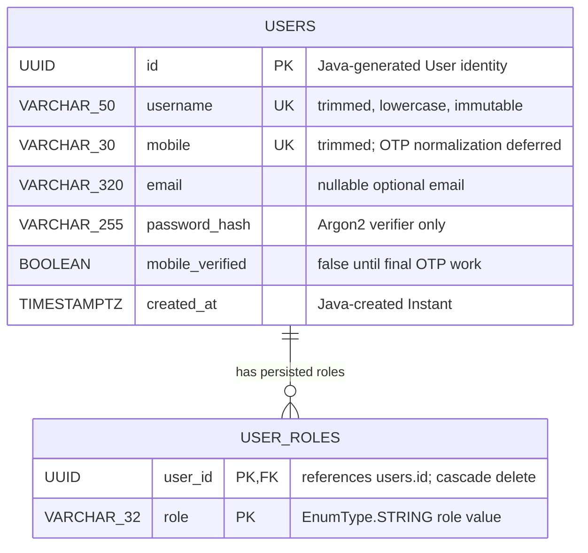
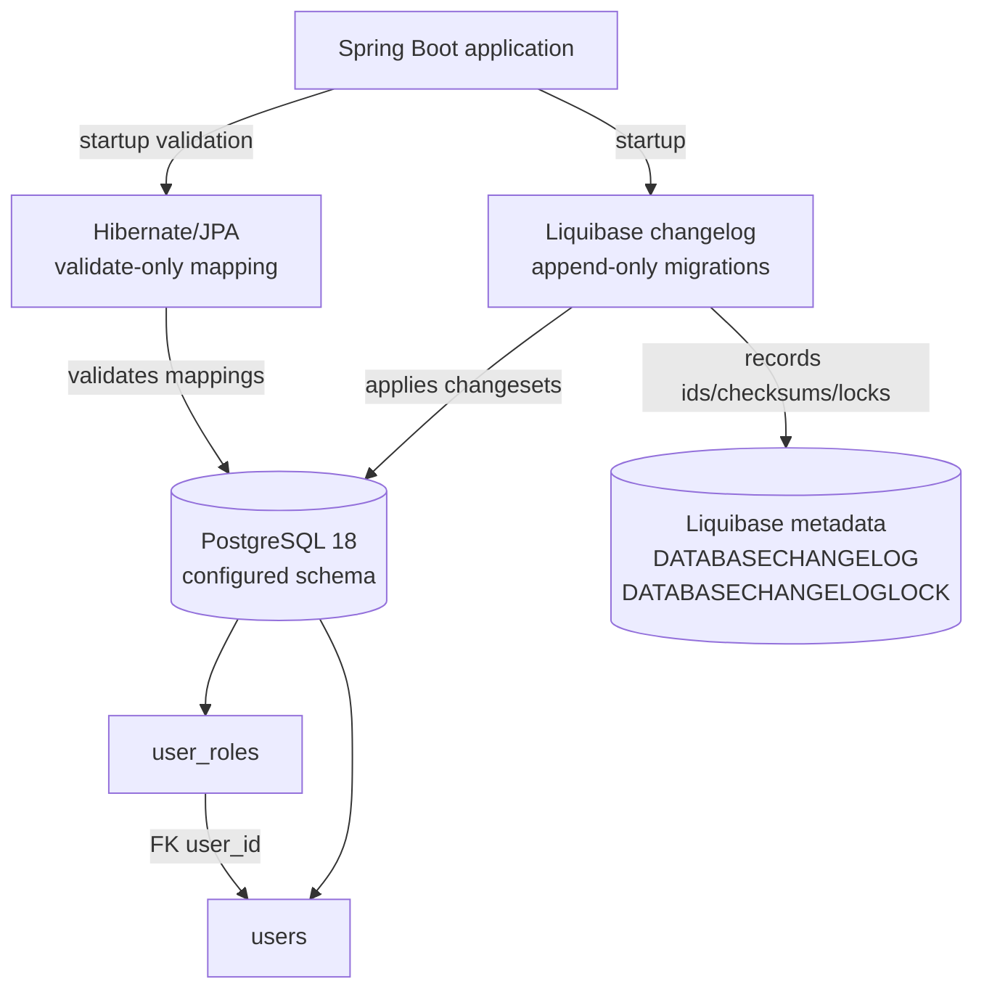

# Backend database architecture

This is the living database architecture map for the backend. It describes the
schema that is currently created by Liquibase and mapped by JPA; it is not a
design claim for tables that belong to later tickets.

**Last reviewed:** 2026-09-18 
**Current scope:** Ticket 01 health baseline and Ticket 02 shared User
registration/authentication/RBAC foundation. 
**Schema source of truth:** [`src/main/resources/db/changelog/db.changelog-master.yaml`](../src/main/resources/db/changelog/db.changelog-master.yaml) 
**Runtime rule:** Liquibase owns schema changes; Hibernate runs with
`ddl-auto: validate` and must not create or alter tables.

## Current entity-relationship diagram

`USER_ROLES` has a composite primary key `(user_id, role)`. A User may have
zero or more persisted roles in the database, although public registration
currently creates exactly one `CUSTOMER` assignment. The current role enum is
`CUSTOMER`, `ADMIN`, `MODERATOR`, and `DELIVERY_PERSON`; the database stores
these as strings and the application owns the allowed vocabulary.

## Persistence and migration boundary

The integration harness points the same migration pipeline at an isolated
PostgreSQL schema. It does not use a second schema model or an in-memory
substitute.

## Current tables and invariants

| Table | Ownership | Important columns and constraints | Meaning |
| --- | --- | --- | --- |
| `users` | `bd.mediwish.user.User` | `id` primary key; `username` unique and not null; `mobile` unique and not null; optional `email`; non-null `password_hash`; non-null `mobile_verified`; non-null `created_at` | Shared identity/profile and credential verifier for Customers and future staff roles. |
| `user_roles` | `User.roles` via `@ElementCollection` | Composite primary key `(user_id, role)`; `user_id` foreign key to `users.id` with `ON DELETE CASCADE`; non-null role | Role assignments used by Spring Security for current authorization. |
| `DATABASECHANGELOG` | Liquibase | Tool-managed applied-change records | Migration history and checksum protection; not application domain data. |
| `DATABASECHANGELOGLOCK` | Liquibase | Tool-managed migration lock | Prevents concurrent Liquibase updates; not application domain data. |

### Data and security rules

- `password_hash` contains only an Argon2 password verifier. Plaintext
  passwords, OTPs and credentials are not database architecture fields and
  must not be logged or returned by an API.
- `username` is normalized by `UserService` before lookup and registration;
  JPA marks it non-updatable. The shared normalization seam is intentionally
  deferred to Ticket 03.T1 until mobile/email login identifiers are designed.
- `mobile` is trimmed and length-bounded in Ticket 02. Country/E.164
  normalization, verification and account-linking semantics belong to Ticket
  61 and are not represented as implemented schema here.
- Public registration cannot supply roles. The service constructs a User with
  `CUSTOMER`; later staff enrollment/RBAC work may add controlled role
  mutation paths.
- `mobile_verified` is retained as persisted state but remains false for the
  reduced flow. Ticket 61 owns the final OTP transition.
- The table rename from `customers` to `users` preserves the applied
  migration history; `customers` is not a current application table.

## Liquibase history

| Changeset | Current effect | Why it matters |
| --- | --- | --- |
| `001-foundation` | Adds the `application-baseline` database tag. | Establishes the migration baseline without domain tables. |
| `002-customers` | Originally creates `customers` with identity, contact, verifier and mobile-state columns plus uniqueness constraints. | Applied history is retained for checksum stability. |
| `003-customer-java-owned-values` | Removes database defaults for `id` and `created_at`. | Java `User` now owns UUID and `Instant` creation while Liquibase remains append-only. |
| `004-shared-users-and-roles` | Renames `customers` to `users`, creates `user_roles`, adds the cascading foreign key and backfills `CUSTOMER` for existing rows. | Implements the shared User resource and role-based authorization boundary. |

When a later ticket changes persistence, add a new append-only changeset and
update this page in the same change. Do not rewrite an applied changeset to
make the diagram look current; record the historical transition instead.

## Update checklist

Update this document whenever any of the following changes:

1. A Liquibase changeset creates, renames, alters or removes a table, column,
   index, constraint or trigger.
2. A JPA entity changes its table/column mapping, relationship, fetch mode,
   enum persistence or ownership rule.
3. A repository/service introduces a new persistence boundary or changes a
   uniqueness, cascade, transaction or privacy invariant.
4. A ticket changes which data is deliberately deferred, such as OTP,
   sessions, recovery, catalog or orders.

After editing, compare the ER diagram and invariant tables with the current
changelog and entity mappings, then run the backend migration/integration
checks. This page documents the current architecture; future tables should be
added only when their ticket and migration exist.
