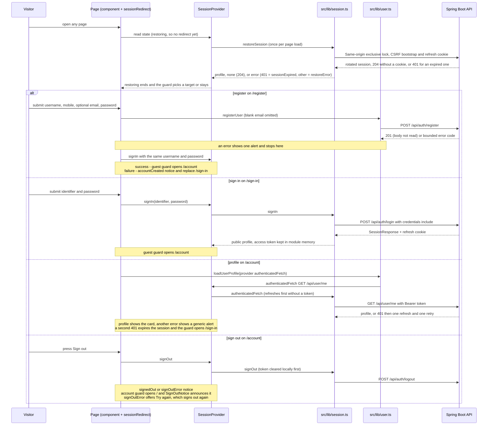

# Frontend code architecture

This is the living code map for the current Next.js frontend. The source tree
remains authoritative; this page documents the route structure, the
server/client boundary, the shared session state and the small API client
seams.

**Last reviewed:** 2026-10-15 
**Current scope:** application shell, English localization, health probe
boundary, and the Ticket 03.01 designed storefront routes: home, sign-in,
registration (Ticket 02), account with sign-out (Ticket 03 browser session),
the staff authenticator setup, code and verified staff landing (Ticket 06),
the editable customer profile with pending mobile changes (Ticket 11), the
Admin Users and roles pages (Ticket 08) and the staff Product and Category
catalog pages (Ticket 14), including the existing Product image editor (Ticket 15)
and Admin Discounts with current effective prices and derived history (Ticket 16). Storefront search, cart, orders, the staff
dashboard, OTP, backup-code sign-in, recovery and OAuth screens are not
implemented in this slice.

Ticket08 adds `/admin/users` and `/admin/users/[userId]` in the staff route group. UserList and UserRoleForm use the shared session guard and `authenticatedFetch` through the bounded `lib/adminUsers` client; private username filters travel only in POST bodies and route IDs are UUIDs. The forms render one role, explicit disabled reasons, busy/error/retry states and the latest20 history entries. The session guard resolves in the browser; dynamic detail IDs are validated before any API call. Admin document responses carry no-store.

## Application dependency diagram

```mermaid
flowchart TD
    BROWSER[Browser]

    subgraph APP[src/app - Next.js routes]
        LAYOUT[layout.tsx<br/>server document shell]
        CSS[globals.css<br/>ported design tokens]
        STORE["(store)/layout.tsx<br/>store group"]
        HOME["(store)/page.tsx<br/>/"]
        ACCOUNTPAGE["(store)/account/page.tsx<br/>/account"]
        PROFILEPAGE["(store)/account/profile/page.tsx<br/>/account/profile"]
        AUTH["(auth)/layout.tsx<br/>auth group"]
        SIGNINPAGE["(auth)/sign-in/page.tsx<br/>/sign-in"]
        REGISTERPAGE["(auth)/register/page.tsx<br/>/register"]
        ENROLLPAGE["(auth)/staff/mfa/enroll/page.tsx<br/>/staff/mfa/enroll"]
        CHALLENGEPAGE["(auth)/staff/mfa/page.tsx<br/>/staff/mfa"]
        STAFFGROUP["(staff)/layout.tsx<br/>staff group"]
        STAFFPAGE["(staff)/staff/page.tsx<br/>/staff"]
        PRODUCTLISTPAGE["(staff)/staff/products/page.tsx<br/>/staff/products"]
        PRODUCTNEWPAGE["(staff)/staff/products/new/page.tsx<br/>/staff/products/new"]
        PRODUCTEDITPAGE["(staff)/staff/products/[productId]/page.tsx<br/>/staff/products/{id}"]
        CATEGORYPAGE["(staff)/staff/categories/page.tsx<br/>/staff/categories"]
        DISCOUNTPAGE["(staff)/staff/discounts/page.tsx<br/>/staff/discounts"]
    end

    subgraph AUTHF[src/auth - client]
        PROVIDER[SessionProvider.tsx<br/>shared session state]
        REDIRECT[sessionRedirect.ts<br/>browser redirect rules]
        SIGNIN[SignInForm.tsx]
        REGISTER[RegistrationForm.tsx]
        NOTICE[SignOutNotice.tsx]
        ENROLL[MfaEnrollment.tsx<br/>QR, code, backup codes]
        CHALLENGE[MfaChallenge.tsx]
    end

    subgraph ACCOUNTF[src/account - client]
        SUMMARY[AccountSummary.tsx]
        PROFILEFORM[ProfileForm.tsx]
        MOBILE[MobileChangeDialog.tsx]
    end

    subgraph STAFFF[src/staff - client]
        STAFFHOME[StaffHome.tsx]
    end

    subgraph CATALOGF[src/catalog - client]
        PRODUCTLIST[ProductList.tsx]
        PRODUCTEDITOR[ProductEditor.tsx]
        CATEGORYMANAGER[CategoryManager.tsx]
        DISCOUNTMANAGER[DiscountManager.tsx]
        DISCOUNTDIALOG[DiscountDialog.tsx]
    end
    ADMINPAGES[Admin user route wrappers]
    ADMINCOMP[UserList / UserRoleForm]
    ADMINLIB[adminUsers.ts<br/>bounded search/detail/role client]
    STAFFGROUP --> ADMINPAGES
    ADMINPAGES --> ADMINCOMP
    ADMINCOMP --> REDIRECT
    ADMINCOMP --> PROVIDER
    ADMINCOMP --> ADMINLIB
    ADMINLIB --> SESSION
    ADMINLIB --> APIMOD

    subgraph SHELL[src/shell]
        SITEHEADER[SiteHeader.tsx<br/>client]
        AUTHHEADER[AuthHeader.tsx]
        STAFFHEADER[StaffHeader.tsx<br/>client]
        PARTS[Logo, Icon, Alert]
    end

    subgraph LIB[src/lib - client seams]
        SESSION[session.ts<br/>memory-only access session]
        USER[user.ts<br/>registration + profile client]
        STAFF[staff.ts<br/>staff access client]
        CATALOG[catalog.ts<br/>staff Product and Category client]
        DISCOUNTS[discounts.ts<br/>bounded discount client]
        PROFILE[profile.ts<br/>editable profile client]
        IDENTIFIERS[identifiers.ts<br/>profile email format]
        APIMOD[api.ts<br/>request, timeout, bounded errors]
        HEALTH[health.ts<br/>health response probe]
    end

    DISCOUNTPAGE --> DISCOUNTMANAGER
    DISCOUNTMANAGER --> PROVIDER
    DISCOUNTMANAGER --> STAFF
    DISCOUNTMANAGER --> DISCOUNTDIALOG
    DISCOUNTMANAGER --> DISCOUNTS
    DISCOUNTDIALOG --> DISCOUNTS
    DISCOUNTDIALOG --> CATALOG
    DISCOUNTS --> SESSION
    DISCOUNTS --> APIMOD

    I18N[src/i18n/request.ts + messages/en.json]
    API[Spring Boot API<br/>127.0.0.1:8080 by default]
    QRCODE[qrcode package<br/>local SVG rendering]
    TESTS[tests + tools<br/>unit, integration and health probe]

    BROWSER --> LAYOUT
    LAYOUT --> I18N
    LAYOUT --> CSS
    LAYOUT --> PROVIDER
    LAYOUT --> STORE
    LAYOUT --> AUTH
    STORE --> SITEHEADER
    STORE --> HOME
    STORE --> ACCOUNTPAGE
    STORE --> PROFILEPAGE
    PROFILEPAGE --> PROFILEFORM
    SUMMARY -->|Edit profile| PROFILEPAGE
    PROFILEFORM --> MOBILE
    PROFILEFORM --> REDIRECT
    PROFILEFORM --> PROVIDER
    PROFILEFORM --> IDENTIFIERS
    PROFILEFORM --> PROFILE
    PROFILE -->|authenticatedFetch| SESSION
    PROFILE --> APIMOD
    AUTH --> AUTHHEADER
    AUTH --> SIGNINPAGE
    AUTH --> REGISTERPAGE
    AUTH --> ENROLLPAGE
    AUTH --> CHALLENGEPAGE
    LAYOUT --> STAFFGROUP
    STAFFGROUP --> STAFFHEADER
    STAFFGROUP --> STAFFPAGE
    STAFFGROUP --> PRODUCTLISTPAGE
    STAFFGROUP --> PRODUCTNEWPAGE
    STAFFGROUP --> PRODUCTEDITPAGE
    STAFFGROUP --> CATEGORYPAGE
    ENROLLPAGE --> ENROLL
    CHALLENGEPAGE --> CHALLENGE
    STAFFPAGE --> STAFFHOME
    PRODUCTLISTPAGE --> PRODUCTLIST
    PRODUCTNEWPAGE --> PRODUCTEDITOR
    PRODUCTEDITPAGE --> PRODUCTEDITOR
    CATEGORYPAGE --> CATEGORYMANAGER
    ENROLL --> QRCODE
    ENROLL --> REDIRECT
    CHALLENGE --> REDIRECT
    STAFFHOME --> REDIRECT
    ENROLL --> PROVIDER
    CHALLENGE --> PROVIDER
    STAFFHEADER --> PROVIDER
    STAFFHOME -->|fetchStaffAccess via provider authenticatedFetch| STAFF
    PRODUCTEDITOR --> STAFF
    PRODUCTLIST --> CATALOG
    PRODUCTEDITOR --> CATALOG
    CATEGORYMANAGER --> CATALOG
    CATALOG -->|authenticatedFetch| SESSION
    CATALOG --> APIMOD
    CATALOG -->|authenticated staff catalog and pricing routes| API
    STAFF --> APIMOD
    HOME --> NOTICE
    ACCOUNTPAGE --> SUMMARY
    SIGNINPAGE --> SIGNIN
    REGISTERPAGE --> REGISTER
    SITEHEADER --> PARTS
    AUTHHEADER --> PARTS
    SIGNIN --> REDIRECT
    REGISTER --> REDIRECT
    SUMMARY --> REDIRECT
    REDIRECT --> PROVIDER
    SIGNIN --> PROVIDER
    REGISTER --> PROVIDER
    NOTICE --> PROVIDER
    SUMMARY --> PROVIDER
    SITEHEADER --> PROVIDER
    PROVIDER --> SESSION
    REGISTER -->|registerUser| USER
    SUMMARY -->|loadUserProfile via provider authenticatedFetch| USER
    USER -->|authenticatedFetch| SESSION
    REGISTER -->|errorMessageKey| APIMOD
    SIGNIN -->|errorMessageKey| APIMOD
    SESSION --> APIMOD
    USER --> APIMOD
    SESSION -->|csrf/login/refresh/logout, MFA enrollment and verify<br/>user, staff and profile routes with Bearer| API
    USER -->|POST /api/auth/register| API
    HEALTH -->|GET /actuator/health/*| API
    TESTS --> PROVIDER
    TESTS --> USER
    TESTS --> SESSION
    TESTS --> HEALTH
```

`layout.tsx`, the route-group layouts, the page files, `request.ts` and message
loading run on the server side of the Next.js boundary, and every route is
statically generated. `AuthHeader` and `Logo` have no client directive and
render on the server inside the auth layout. `SessionProvider`, the forms,
`SignOutNotice`, `AccountSummary`, `SiteHeader`, `MfaEnrollment`,
`MfaChallenge`, `StaffHome`, `StaffHeader`, `ProductList`, `ProductEditor`, `CategoryManager` and `Alert` are client components
because they own state, browser events, focus or navigation. `(store)`,
`(auth)` and `(staff)` are route groups, so they add no URL segment. The
`/staff/*` responses carry `Cache-Control: no-store` from `next.config.ts`.

## Session state and redirects

The root layout mounts one `SessionProvider` above all three route groups, so the
state survives client-side navigation between them. The provider is the only
React consumer of `src/lib/session.ts`; forms, the header and the account page
read it through `useSession`.

`sessionRedirect` is a pure function of the guard and the provider state:

- nothing moves while the restore is running, because the refresh credential
  is an HttpOnly cookie on the API origin and the session is known only in the
  browser;
- the `account` guard sends signed-out visitors to `/sign-in`, sends them to `/`
  right after a sign-out (`signedOut` or `signOutError`), and stays put while
  sign-out is pending;
- a signed-in session has one home page chosen by its MFA status
  (`NOT_REQUIRED` `/account`, `ENROLLMENT_REQUIRED` `/staff/mfa/enroll`,
  `VERIFICATION_REQUIRED` `/staff/mfa`, `VERIFIED` `/staff`). The `guest` guard
  (sign-in and registration) sends signed-in users there, so sign-in success
  lands without an explicit navigation in the form;
- the `mfa-enrollment`, `mfa-challenge` and `staff` guards admit only their own
  status, send other sessions to their home page and signed-out visitors to
  `/sign-in`; `account` admits `NOT_REQUIRED` and `VERIFIED`. Setup holds its
  redirect while a code is verifying and while the backup codes are shown.

Redirects use `router.replace` with fixed paths; no identifier, credential or
token is placed in a URL. The store header renders no account link until the
restore finishes. The provider clears local state even when the server
sign-out fails, because the session client drops the in-memory token before it
calls the API.

## Session client seam

`src/lib/session.ts` is the only browser holder of access credentials. It
keeps the access JWT in module memory, never in storage, URLs or logs, and
reaches the API through `src/lib/api.ts`, which gives every request
`no-store`, `redirect: 'error'`, a 10-second operation timeout and a bounded
`ApiError` (code and status only). Sign-in, refresh and logout hold one
same-origin exclusive Web Lock from the CSRF bootstrap until the response is
read, so tabs apply refresh-cookie rotations in order. Web Locks exist only in
a secure context; without them, as over plain HTTP at a LAN address, a
module-level promise chain serializes the same operations within the tab only.
Epochs discard results that a sign-out or a dropped token made stale.

A refresh `204` means no refresh cookie (signed out) and a `401` means an
expired or revoked one. `authenticatedFetch` refreshes first when no token is
in memory, and refreshes and retries once after a `401`; a `401` after that
single refresh ends the session. The provider wraps it, so that final `401`
also clears the profile and shows the session-expired notice.

The mounted UI calls `signIn`, `restoreSession`, `signOut` and
`authenticatedFetch` through the provider. `/account` loads
`GET /api/user/me` with `loadUserProfile` through the provider's
`authenticatedFetch`, and registration calls `registerUser`. Forms turn error
codes into `messages/en.json` copy with `errorMessageKey`; the API's own
message text is never shown.

Staff MFA goes through the same seam. `startMfaEnrollment` uses
`authenticatedFetch`; `verifyMfaEnrollment` and `verifyMfa` send the restricted
Bearer token with the refresh cookie inside the cookie-mutation lock, then
store the verified access token and advance the session epoch. The provider
records only the new MFA status; the setup key, otpauth URI and backup codes
are returned to the page component, which keeps them in state, clears them on
`pagehide` and unmount, and draws the QR code locally with `qrcode`.

## Editable profile seam

The profile route loads GET `/api/user/me/profile`, then sends exactly full name, email, date of birth and the loaded version on PUT. A successful save replaces the baseline and focuses the success notice; STALE_UPDATE offers Reload. Username and current mobile are text. The native dialog stages a proposed mobile with POST `/api/user/me/mobile-change`; DELETE cancels it. Stage/cancel preserve the field draft, baseline and version so another tab's save remains detectable.

One in-flight marker excludes competing profile commands. The provider publishes a reducer-owned generation on session transitions, while refresh leaves it stable. The form hides old data and drops late answers when that generation changes, including sign-out followed by sign-in with the same user object. ACCOUNT_CLOSING disables fields and commands while leaving existing pending-mobile information readable. SMS, OTP and activation remain later-ticket work.

## Module responsibilities

| Module | Responsibility | Boundary |
| --- | --- | --- |
| `src/app/layout.tsx` | Root HTML shell, metadata title template, `NextIntlClientProvider` and the single `SessionProvider`. | Server component boundary. |
| `src/app/(store)/*` | Store layout with `SiteHeader`; home page (`/`) account page (`/account`) and profile editor (`/account/profile`). | Server route files composing client components. |
| `src/app/(auth)/*` | Auth layout with `AuthHeader` and centered card; sign-in (`/sign-in`), registration (`/register`), authenticator setup (`/staff/mfa/enroll`) and code (`/staff/mfa`) pages. | Server route files composing client components. |
| `src/app/(staff)/*` | Staff layout with `StaffHeader`; `/staff`, Products list/new/edit and Categories routes. | Server route files compose client components; edit reads `useParams` in the browser. |
| `src/app/globals.css` | Design tokens and component styles ported from `agent-docs/ui-design/assets/styles.css`, limited to the current pages. | Global stylesheet. |
| `src/auth/` | Session provider and reducer, redirect rules, sign-in and registration forms, sign-out notice, authenticator setup, code entry, code field and backup-code panel. | Client UI and state; network only through `src/lib`. |
| `src/account/` | Account summary, editable profile and native mobile-change dialog; dirty drafts, optimistic version, stale reload and closure state. | Client UI; calls use `user.ts` or `profile.ts` through the provider. |
| `src/staff/` | Staff landing: loads `GET /api/staff/me` for a verified session and shows the username, role, Super Admin label and role-appropriate links (Users and roles for Admins; Products and Categories for Admins and Moderators). | Client UI; the call goes through `staff.ts` and the provider. |
| `src/catalog/` | Products table and filters, Product new/edit forms, image management, separate Admin pricing form, inline Categories manager and Admin Discounts. | Client UI; every route waits for verified MFA and uses the catalog, image or discount client through the provider. |
| `src/shell/` | Store, auth and staff headers, logo, decorative icons and the alert component. | Presentation; `SiteHeader` reads session state. |
| `src/lib/api.ts` | Base URL, request defaults, 10-second timeout, 16 KiB default JSON bound with a caller-specified larger success bound, `ApiError` and error-code-to-copy key. | Shared HTTP boundary for the API clients. |
| `src/lib/session.ts` | Login, CSRF bootstrap, MFA status, enrollment start and verification with token replacement, memory-only access token, cross-tab cookie-mutation Web Lock, refresh single-flight, restore (`204` none, `401` expired), Bearer requests with one refresh and retry, epoch invalidation and logout. | Injectable browser session seam; refresh credentials remain cookie-backed. |
| `src/lib/user.ts` | Registration (any `201` succeeds) and the `GET /api/user/me` profile through `authenticatedFetch`, with field projection. | Network seam to the backend; no credential persistence. |
| `src/lib/profile.ts` | Nine-field profile projection and GET/PUT profile, POST/DELETE mobile-change commands with strict expected statuses. | Caller-owned authenticated network seam; no identifier URLs. |
| `src/lib/identifiers.ts` | Accepted ASCII dot-atom email validation for new profile input. | Pure function; the backend remains authoritative. |
| `src/lib/staff.ts` | `GET /api/staff/me` through `authenticatedFetch`, with bounded projection of username, roles and Super Admin flag. | Network seam to the backend. |
| `src/lib/catalog.ts` | Staff Product/Category reads and commands through `authenticatedFetch`, strict response projections, BDT string formatting and client UUIDs. | Catalog and pricing routes are separate; valid 50-item success pages use a 256 KiB response bound. |
| `src/lib/health.ts` | Parallel liveness/readiness probe with bounded result states and timeout. | Operational probe seam. |
| `src/i18n/request.ts` | Selects the English locale and loads the message catalog. | Server localization boundary. |
| `messages/en.json` | User-visible English strings by feature namespace (`metadata`, `header`, `home`, `signIn`, `register`, `account`, `profile`, `staffMfa`, `staffHome`, `adminUsers`, `catalog`, `categories`, `errors`). | Externalized message source, including the BDT symbol. |
| `tests/` and `tools/` | Exercise the API seams, provider and redirect rules, mounted pages' components (with real session clients over the shared `fakeApi` routes), health integration and the supported probe path. | Verification boundary; synthetic data only. |

## Frontend safety rules

- Keep credentials, tokens, OTPs, MFA keys, backup codes, personal data and
  order data out of browser storage, URLs, logs and ordinary error text.
- Keep backend errors bounded to a code and status, and show only the
  `messages/en.json` copy chosen for the code, never the API's message.
- Keep `session.ts`, `user.ts`, `catalog.ts` and `health.ts` injectable through their fetch or
  cookie options, and `SessionProvider` injectable through its `source`, so
  unit tests do not require a running backend; reserve real API behavior for
  integration/browser checks.
- Keep all user-visible strings in `messages/`, render alerts only when they
  occur, and move focus to notices that replace the page's context.

## Update checklist

Update this page whenever a route, route group, server/client boundary,
component, library API, message namespace, network contract or test/tool
boundary changes. Keep the diagrams aligned with the current source and tested
behavior. Add future OTP, storefront search, cart or order nodes only when their
implementation and contract are actually introduced.

## Ticket 15 image flow

`src/catalog/ProductImages.tsx` adds the accepted Images card to an existing Product editor. It uses the current session client through `src/lib/productImages.ts`; one pending command disables controls and the upload retry retains its original UUID, File, description and replacement identity. Metadata saves carry the displayed image version, and Make main image carries the entire displayed order as its stale-update precondition. Loading/error states, native dialog confirmation and focus targets follow the staff edit design.

`ProductImage.tsx` provides dimensions, alt text and an accessible failure placeholder through `next/image`. `src/lib/imageConfig.ts` defines the optimizer's exact API-origin/public-image path boundary; Next's image settings disallow local paths and redirects, retain no disk cache and cap cache lifetime at60seconds. It produces WebP for display while uploads remain PNG/JPEG only. The public Product page remains Ticket17 scope.

## Ticket 16 discount flow

`/staff/discounts` is a server metadata/route wrapper over `DiscountManager`. The verified Admin view owns list status/page/counts and refresh; `DiscountDialog` owns one create/edit/end interaction and target-picker state. `discounts.ts` projects bounded API responses and passes exact commands through the session seam. Unknown create outcomes retain the original command and UUID until identical retry or cancel/refresh. Catalog Product/history projections and displays consume the backend's effective price and applied discount; browsers never perform customer-price arithmetic. Focused unit tests protect error recovery, stale reads, field focus, request bodies and current-price/history copy. Real HTTP and browser acceptance remain separate verification gates.
