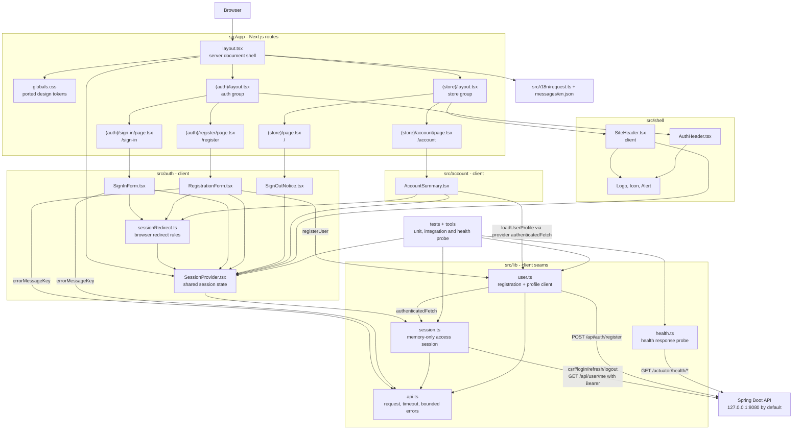
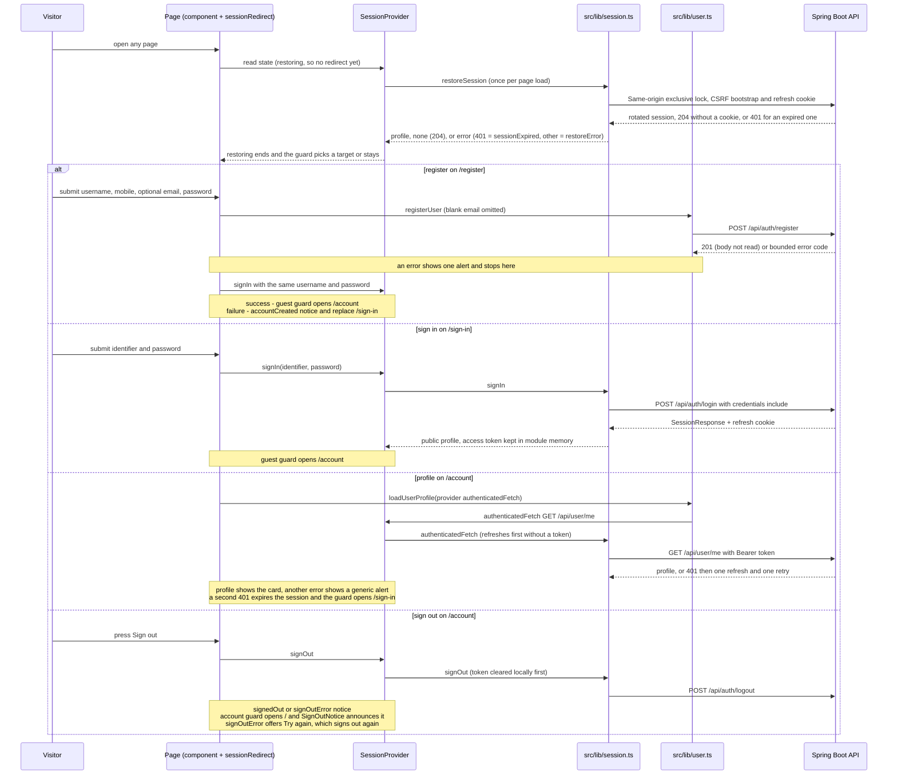

# Frontend code architecture

This is the living code map for the current Next.js frontend. The source tree
remains authoritative; this page documents the route structure, the
server/client boundary, the shared session state and the small API client
seams.

**Last reviewed:** 2026-09-26 
**Current scope:** application shell, English localization, health probe
boundary, and the Ticket 03.01 designed storefront routes: home, sign-in,
registration (Ticket 02) and account with sign-out (Ticket 03 browser session).
Product catalog, search, cart, orders, staff UI, OTP, MFA, recovery and OAuth
screens are not implemented in this slice.

## Application dependency diagram

`layout.tsx`, the route-group layouts, the page files, `request.ts` and message
loading run on the server side of the Next.js boundary, and every route is
statically generated. `AuthHeader` and `Logo` have no client directive and
render on the server inside the auth layout. `SessionProvider`, the forms,
`SignOutNotice`, `AccountSummary`, `SiteHeader` and `Alert` are client
components because they own state, browser events, focus or navigation.
`(store)` and `(auth)` are route groups, so they add no URL segment.

## Session state and redirects

The root layout mounts one `SessionProvider` above both route groups, so the
state survives client-side navigation between them. The provider is the only
React consumer of `src/lib/session.ts`; forms, the header and the account page
read it through `useSession`.

`sessionRedirect` is a pure function of the guard and the provider state:

- nothing moves while the restore is running, because the refresh credential
  is an HttpOnly cookie on the API origin and the session is known only in the
  browser;
- the `account` guard sends signed-out visitors to `/sign-in`, sends them to `/`
  right after a sign-out (`signedOut` or `signOutError`), and stays put while
  sign-out is pending;
- the `guest` guard (sign-in and registration) sends signed-in users to
  `/account`. Sign-in success reaches `/account` this way, not by an explicit
  navigation in the form.

Redirects use `router.replace` with fixed paths; no identifier, credential or
token is placed in a URL. The store header renders no account link until the
restore finishes. The provider clears local state even when the server
sign-out fails, because the session client drops the in-memory token before it
calls the API.

## Session client seam

`src/lib/session.ts` is the only browser holder of access credentials. It
keeps the access JWT in module memory, never in storage, URLs or logs, and
reaches the API through `src/lib/api.ts`, which gives every request
`no-store`, `redirect: 'error'`, a 10-second operation timeout and a bounded
`ApiError` (code and status only). Sign-in, refresh and logout hold one
same-origin exclusive Web Lock from the CSRF bootstrap until the response is
read, so tabs apply refresh-cookie rotations in order. Web Locks exist only in
a secure context; without them, as over plain HTTP at a LAN address, a
module-level promise chain serializes the same operations within the tab only.
Epochs discard results that a sign-out or a dropped token made stale.

A refresh `204` means no refresh cookie (signed out) and a `401` means an
expired or revoked one. `authenticatedFetch` refreshes first when no token is
in memory, and refreshes and retries once after a `401`; a `401` after that
single refresh ends the session. The provider wraps it, so that final `401`
also clears the profile and shows the session-expired notice.

The mounted UI calls `signIn`, `restoreSession`, `signOut` and
`authenticatedFetch` through the provider. `/account` loads
`GET /api/user/me` with `loadUserProfile` through the provider's
`authenticatedFetch`, and registration calls `registerUser`. Forms turn error
codes into `messages/en.json` copy with `errorMessageKey`; the API's own
message text is never shown.

## Module responsibilities

| Module | Responsibility | Boundary |
| --- | --- | --- |
| `src/app/layout.tsx` | Root HTML shell, metadata title template, `NextIntlClientProvider` and the single `SessionProvider`. | Server component boundary. |
| `src/app/(store)/*` | Store layout with `SiteHeader`; home page (`/`) and account page (`/account`). | Server route files composing client components. |
| `src/app/(auth)/*` | Auth layout with `AuthHeader` and centered card; sign-in (`/sign-in`) and registration (`/register`) pages. | Server route files composing client components. |
| `src/app/globals.css` | Design tokens and component styles ported from `agent-docs/ui-design/assets/styles.css`, limited to the current pages. | Global stylesheet. |
| `src/auth/` | Session provider and reducer, redirect rules, sign-in and registration forms, sign-out notice. | Client UI and state; network only through `src/lib`. |
| `src/account/` | Account summary: loads the current profile, shows loading, profile or generic error, and the sign-out button. | Client UI; the profile call goes through `user.ts` and the provider. |
| `src/shell/` | Store and auth headers, logo, decorative icons and the alert component. | Presentation; `SiteHeader` reads session state. |
| `src/lib/api.ts` | Base URL, request defaults and 10-second timeout, 16 KiB JSON reading, `ApiError` and the error-code-to-copy key. | Shared HTTP boundary for the API clients. |
| `src/lib/session.ts` | Login, CSRF bootstrap, memory-only access token, cross-tab cookie-mutation Web Lock, refresh single-flight, restore (`204` none, `401` expired), Bearer requests with one refresh and retry, epoch invalidation and logout. | Injectable browser session seam; refresh credentials remain cookie-backed. |
| `src/lib/user.ts` | Registration (any `201` succeeds) and the `GET /api/user/me` profile through `authenticatedFetch`, with field projection. | Network seam to the backend; no credential persistence. |
| `src/lib/health.ts` | Parallel liveness/readiness probe with bounded result states and timeout. | Operational probe seam. |
| `src/i18n/request.ts` | Selects the English locale and loads the message catalog. | Server localization boundary. |
| `messages/en.json` | User-visible English strings by feature namespace (`metadata`, `header`, `home`, `signIn`, `register`, `account`, `errors`). | Externalized message source. |
| `tests/` and `tools/` | Exercise the API seams, provider and redirect rules, mounted pages' components (with real session clients over the shared `fakeApi` routes), health integration and the supported probe path. | Verification boundary; synthetic data only. |

## Frontend safety rules

- Keep credentials, tokens, OTPs, personal data and order data out of browser
  storage, URLs, logs and ordinary error text.
- Keep backend errors bounded to a code and status, and show only the
  `messages/en.json` copy chosen for the code, never the API's message.
- Keep `session.ts`, `user.ts` and `health.ts` injectable through their fetch or
  cookie options, and `SessionProvider` injectable through its `source`, so
  unit tests do not require a running backend; reserve real API behavior for
  integration/browser checks.
- Keep all user-visible strings in `messages/`, render alerts only when they
  occur, and move focus to notices that replace the page's context.

## Update checklist

Update this page whenever a route, route group, server/client boundary,
component, library API, message namespace, network contract or test/tool
boundary changes. Keep the diagrams aligned with the current source and tested
behavior. Add future OTP, catalog, cart or order nodes only when their
implementation and contract are actually introduced.
