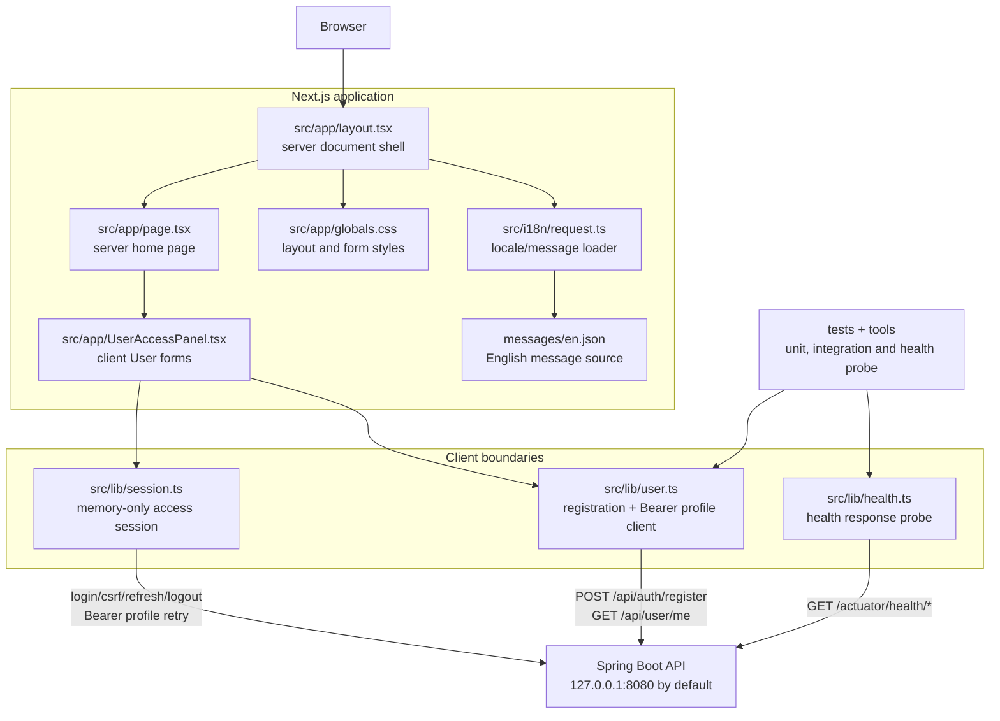

# Frontend code architecture

This is the living code map for the current Next.js frontend. The source tree
remains authoritative; this page documents the server/client boundary, the
small API client seams and the current User access flow.

**Last reviewed:** 2026-09-19<br/>
**Current scope:** application shell, English localization, health probe
boundary, Ticket 02 registration and Ticket 03 browser session flow. Product
catalog, cart, orders, staff UI, OTP, MFA, recovery and OAuth screens are not
implemented in this slice.

## Application dependency diagram



`layout.tsx`, `page.tsx`, `request.ts` and message loading execute on the
server side of the Next.js boundary. `UserAccessPanel.tsx` is the client
component because it owns form state and browser events. `user.ts` is the
explicit network seam and does not store credentials or tokens in browser
storage.

## Current User access flow

```mermaid
sequenceDiagram
    participant V as Visitor
    participant P as UserAccessPanel
    participant U as src/lib/user.ts
    participant S as src/lib/session.ts
    participant A as Spring Boot API

    V->>P: enter registration or sign-in fields
    alt registration
        P->>U: registerUser(input)
        U->>A: POST /api/auth/register
        A-->>U: 201 public RegisteredUser
        U-->>P: validated response
        P-->>V: translated success or bounded error
    else sign-in
        P->>S: signIn(identifier, password)
        S->>A: POST /api/auth/login with credentials include
        A-->>S: SessionResponse + refresh cookie
        S-->>P: validated public profile; access token stays in module memory
        P-->>V: translated success or bounded error
    else reload or expired access
        P->>S: restoreSession or authenticatedFetch
        S->>A: CSRF bootstrap, one shared refresh, optional one retry
        A-->>S: rotated session or bounded authentication failure
        S-->>P: profile or session-expired state
    end
```

Registration and sign-in maintain independent busy/status/error state. Password
fields are cleared after each attempt, error/status regions are stable and
announced accessibly, and API responses are validated before they reach the
component. The session module is the only browser seam for access credentials:
it bootstraps a bounded CSRF nonce response and echoes it in the required
header, while the API manages the matching non-secret cookie. It keeps the
access JWT in module memory without localStorage, sessionStorage, IndexedDB,
URL, console or durable application state.

## Module responsibilities

| Module | Responsibility | Boundary |
| --- | --- | --- |
| `src/app/layout.tsx` | Root HTML shell, metadata and `NextIntlClientProvider`. | Server component boundary. |
| `src/app/page.tsx` | Localized home page and User panel composition. | Server-to-client composition. |
| `src/app/UserAccessPanel.tsx` | Registration/sign-in forms, local state, translated feedback and accessible announcements. | Client UI; no direct database or fetch implementation. |
| `src/lib/session.ts` | Login, CSRF bootstrap, memory-only access token, refresh single-flight/retry, restore and logout cleanup. | Injectable browser session seam; refresh credentials remain cookie-backed. |
| `src/lib/user.ts` | Registration request construction, Bearer profile request delegation, bounded error mapping and response validation. | Network seam to the backend; no credential persistence. |
| `src/lib/health.ts` | Parallel liveness/readiness probe with bounded result states and timeout. | Operational probe seam. |
| `src/i18n/request.ts` | Selects the English locale and loads the message catalog. | Server localization boundary. |
| `messages/en.json` | User-visible English strings for metadata, home and account flows. | Externalized message source. |
| `tests/` and `tools/` | Exercise pure API seams, health integration and the supported probe path. | Verification boundary; synthetic data only. |

## Frontend safety rules

- Keep credentials, tokens, OTPs, personal data and order data out of browser
  storage, URLs, logs and ordinary error text.
- Keep backend error handling bounded and use translated client fallbacks when
  a response is malformed or lacks a safe message.
- Keep `session.ts`, `user.ts` and `health.ts` injectable through their fetch or
  cookie options so
  unit tests do not require a running backend; reserve real API behavior for
  integration/browser checks.
- Keep all user-visible strings in `messages/` and keep accessibility state
  attached to stable mounted elements.

## Update checklist

Update this page whenever a route, server/client boundary, component, library
API, message namespace, network contract or test/tool boundary changes. Keep
the diagrams aligned with the current source and tested behavior. Add future
session, OTP, catalog, cart or order nodes only when their implementation and
contract are actually introduced.
