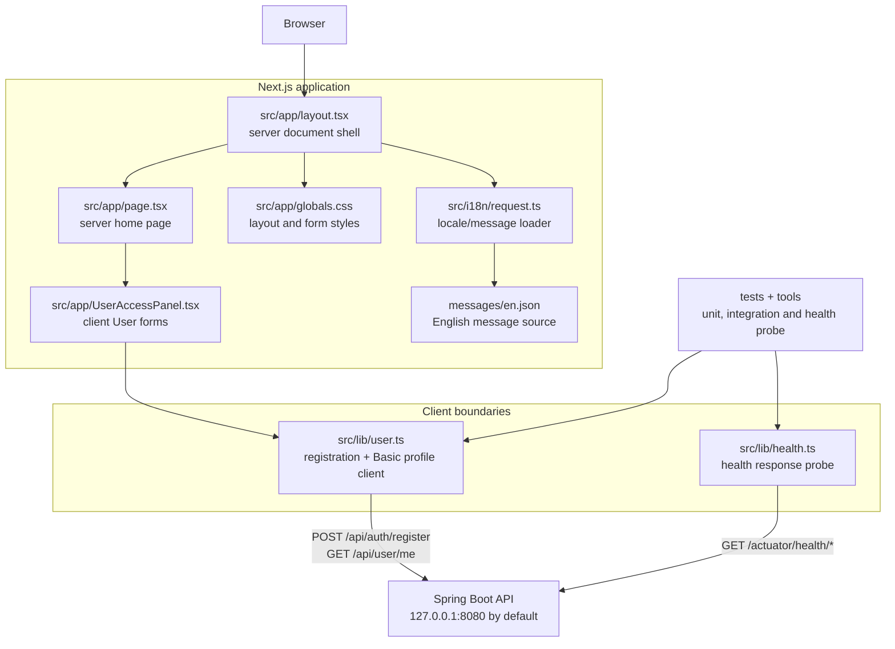
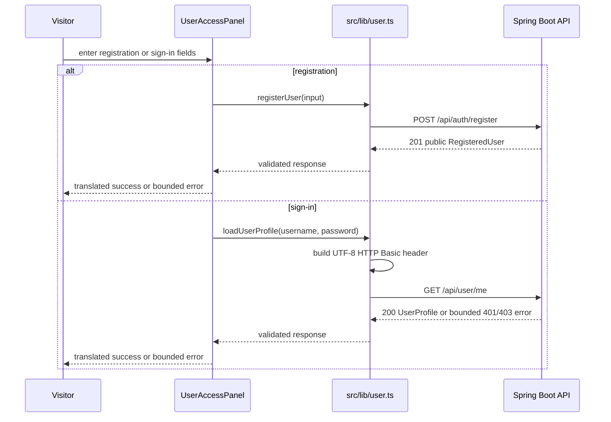

# Frontend code architecture

This is the living code map for the current Next.js frontend. The source tree
remains authoritative; this page documents the server/client boundary, the
small API client seams and the current User access flow.

**Last reviewed:** 2026-09-18 
**Current scope:** application shell, English localization, health probe
boundary and the Ticket 02 User registration/sign-in panel. Product catalog,
cart, orders, staff UI, sessions and OTP screens are not implemented in this
slice.

## Application dependency diagram

`layout.tsx`, `page.tsx`, `request.ts` and message loading execute on the
server side of the Next.js boundary. `UserAccessPanel.tsx` is the client
component because it owns form state and browser events. `user.ts` is the
explicit network seam and does not store credentials or tokens in browser
storage.

## Current User access flow

Registration and sign-in maintain independent busy/status/error state. Password
fields are cleared after each attempt, error/status regions are stable and
announced accessibly, and API responses are validated before they reach the
component. The current Basic transport is deliberately transitional; Ticket
03 owns the JWT/session browser contract.

## Module responsibilities

| Module | Responsibility | Boundary |
| --- | --- | --- |
| `src/app/layout.tsx` | Root HTML shell, metadata and `NextIntlClientProvider`. | Server component boundary. |
| `src/app/page.tsx` | Localized home page and User panel composition. | Server-to-client composition. |
| `src/app/UserAccessPanel.tsx` | Registration/sign-in forms, local state, translated feedback and accessible announcements. | Client UI; no direct database or fetch implementation. |
| `src/lib/user.ts` | Request construction, bounded API error mapping, response validation and Basic header creation. | Network seam to the backend. |
| `src/lib/health.ts` | Parallel liveness/readiness probe with bounded result states and timeout. | Operational probe seam. |
| `src/i18n/request.ts` | Selects the English locale and loads the message catalog. | Server localization boundary. |
| `messages/en.json` | User-visible English strings for metadata, home and account flows. | Externalized message source. |
| `tests/` and `tools/` | Exercise pure API seams, health integration and the supported probe path. | Verification boundary; synthetic data only. |

## Frontend safety rules

- Keep credentials, tokens, OTPs, personal data and order data out of browser
  storage, URLs, logs and ordinary error text.
- Keep backend error handling bounded and use translated client fallbacks when
  a response is malformed or lacks a safe message.
- Keep `user.ts` and `health.ts` injectable through their fetch options so
  unit tests do not require a running backend; reserve real API behavior for
  integration/browser checks.
- Keep all user-visible strings in `messages/` and keep accessibility state
  attached to stable mounted elements.

## Update checklist

Update this page whenever a route, server/client boundary, component, library
API, message namespace, network contract or test/tool boundary changes. Keep
the diagrams aligned with the current source and tested behavior. Add future
session, OTP, catalog, cart or order nodes only when their implementation and
contract are actually introduced.
